# Administrer les services dans une infrastructure distribuée


# TOC
[TOC]
- [AWS](#AWS)
  - [Resources AWS](#Resources%20AWS)
  - [Consignes TP Partie 1 : Introduction à AWS - une première machine linux (branche RHEL)](#Consignes%20TP%20Partie%201%20%20Introduction%20à%20AWS%20-%20%20une%20première%20machine%20linux%20branche%20RHEL)
  - [Consignes TP Partie 2 : une deuxième machine Linux - Architecture N-Tiers](#Consignes%20TP%20Partie%202%20%20une%20deuxième%20machine%20Linux%20-%20Architecture%20N-Tiers)
  - [Consignes TP Partie 3 : Cloud Hybride Distribué sous AWS et Windows Server](#Consignes%20TP%20Partie%203%20%20Cloud%20Hybride%20Distribué%20sous%20AWS%20et%20Windows%20Server)
  - [TP Partie 1](#TP%20Partie%201)
  - [TP Partie 2 : Architecture N-Tiers](#TP%20Partie%202%20%20Architecture%20N-Tiers)
  - [TP Partie 3](#TP%20Partie%203)
- [Azure](#Azure)
	- [Resources Azure](#Resources%20Azure)
	- [Compendium Azure](#Compendium%20Azure)
	- [Jour 1](#Jour%201)
	- [Jour 2](#Jour%202)
	- [Jour 3](#Jour%203)
		- [Create & Connect to a Windows VM](#Create%20&%20Connect%20to%20a%20Windows%20VM)
		- [Create & Connect to a Linux VM](#Create%20&%20Connect%20to%20a%20Linux%20VM)
		- [Blob Storage](#Blob%20Storage)
	- [Jour 4](#Jour%204)
		- [Azure File Sync](#Azure%20File%20Sync)
		- [AD dans le cloud avec VPN S2S](#AD%20dans%20le%20cloud%20avec%20VPN%20S2S)
		- [Azure VPN Site 2 Site with pfSense](#Azure%20VPN%20Site%202%20Site%20with%20pfSense)
	- [Jour 5](#Jour%205)
		- [TP final : AzureAD & Azure AD Connect](#TP%20final%20%20AzureAD%20&%20Azure%20AD%20Connect)

---

# AWS

Sem du 23/08/2021 au 27/08/2021  \
Intervenant [Bauze NJANBOU TCHATO](https://www.linkedin.com/in/bauze-njanbou-tchato-073663110/)


## Resources AWS

- CAMPUS : https://campus.cefim.eu/enrol/index.php?id=836
- AWS Cloud Practitioner Essentials 6h : https://aws.amazon.com/fr/training/course-descriptions/cloud-practitioner-essentials/ (https://www.aws.training/Details/eLearning?id=60697)
- AWS Glossary : https://docs.aws.amazon.com/general/latest/gr/glos-chap.html

---


Jour 1 : Plateform AWS Training, realisation du cours (module 1 to 6) **[AWS Cloud Practitioner Essentials](https://www.aws.training/Details/eLearning?id=60697)** 


**Module 1 resources** :
-   [AWS glossary](https://docs.aws.amazon.com/general/latest/gr/glos-chap.html)
-   [Whitepaper: Overview of Amazon Web Services](https://d0.awsstatic.com/whitepapers/aws-overview.pdf)
-   [AWS Fundamentals: Overview](https://aws.amazon.com/getting-started/fundamentals-overview/)[  
    ](https://aws.amazon.com/what-is-cloud-computing/)
-   [What is cloud computing?](https://aws.amazon.com/what-is-cloud-computing/)
-   [Types of cloud computing](https://aws.amazon.com/types-of-cloud-computing/)
-   [Cloud computing with AWS](https://aws.amazon.com/what-is-aws/)

<br>

**Module 2 : Compute in the Cloud**

[**Amazon Elastic Container Service (Amazon ECS)**](https://aws.amazon.com/ecs/) is a highly scalable, high-performance container management system that enables you to run and scale containerized applications on AWS. 

Amazon ECS supports Docker containers. [Docker](https://www.docker.com/) is a software platform that enables you to build, test, and deploy applications quickly. AWS supports the use of open-source Docker Community Edition and subscription-based Docker Enterprise Edition. With Amazon ECS, you can use API calls to launch and stop Docker-enabled applications.

[**Amazon Elastic Kubernetes Service (Amazon EKS)**](https://aws.amazon.com/eks/) is a fully managed service that you can use to run Kubernetes on AWS. 

[Kubernetes](https://kubernetes.io/) is open-source software that enables you to deploy and manage containerized applications at scale. A large community of volunteers maintains Kubernetes, and AWS actively works together with the Kubernetes community. As new features and functionalities release for Kubernetes applications, you can easily apply these updates to your applications managed by Amazon EKS.

[**AWS Fargate**](https://aws.amazon.com/fargate/) is a serverless compute engine for containers. It works with both Amazon ECS and Amazon EKS. 

When using AWS Fargate, you do not need to provision or manage servers. AWS Fargate manages your server infrastructure for you. You can focus more on innovating and developing your applications, and you pay only for the resources that are required to run your containers.

**Additional resources**
-   [Amazon SNS](https://aws.amazon.com/sns)
-   [Compute on AWS](https://aws.amazon.com/products/compute)
-   [AWS Compute Blog](https://aws.amazon.com/blogs/compute/)
-   [AWS Compute Services](https://docs.aws.amazon.com/whitepapers/latest/aws-overview/compute-services.html)
-   [Hands-On Tutorials: Compute](https://aws.amazon.com/getting-started/hands-on/?awsf.getting-started-category=category%23compute&awsf.getting-started-content-type=content-type%23hands-on)
-   [Category Deep Dive: Serverless](https://aws.amazon.com/getting-started/deep-dive-serverless/)
-   [AWS Customer Stories: Serverless](https://aws.amazon.com/solutions/case-studies/?customer-references-cards.sort-by=item.additionalFields.publishedDate&customer-references-cards.sort-order=desc&awsf.customer-references-location=*all&awsf.customer-references-segment=*all&awsf.customer-references-product=product%23vpc%7Cproduct%23api-gateway%7Cproduct%23cloudfront%7Cproduct%23route53%7Cproduct%23directconnect%7Cproduct%23elb&awsf.customer-references-category=category%23serverless)

<br>

**Module 3: Global Infrastructure and Reliability resources**

-   [AWS global infrastructure](https://aws.amazon.com/about-aws/global-infrastructure)
-   [Regions and Availability Zones](https://aws.amazon.com/about-aws/global-infrastructure/regions_az)
-   [Global Infrastructure](https://aws.amazon.com/about-aws/global-infrastructure/)
-   [Interactive map of the AWS Global Infrastructure](https://www.infrastructure.aws/)
-   [Regions and Availability Zones](https://aws.amazon.com/about-aws/global-infrastructure/regions_az)
-   [AWS Networking and Content Delivery Blog](https://aws.amazon.com/blogs/networking-and-content-delivery/)
-   [Tools to Build on AWS](https://aws.amazon.com/tools/)
-   [AWS Customer Stories: Content Delivery](https://aws.amazon.com/solutions/case-studies/?customer-references-cards.sort-by=item.additionalFields.publishedDate&customer-references-cards.sort-order=desc&awsf.customer-references-location=*all&awsf.customer-references-segment=*all&awsf.customer-references-product=product%23vpc%7Cproduct%23api-gateway%7Cproduct%23cloudfront%7Cproduct%23route53%7Cproduct%23directconnect%7Cproduct%23elb&awsf.customer-references-category=category%23content-delivery)
-   [Amazon CloudFront](https://aws.amazon.com/cloudfront)
-   [Choosing Regions and Availability Zones](https://docs.aws.amazon.com/AmazonElastiCache/latest/mem-ug/RegionsAndAZs.html)
- [Amazon CloudFront infrastructure](https://aws.amazon.com/cloudfront/features/?nc=sn&loc=2#Amazon_CloudFront_Infrastructure)
- [AWS Outposts](https://aws.amazon.com/outposts/)


**Module 4: Networking resources**

-   [Networking and Content Delivery on AWS](https://aws.amazon.com/products/networking)
-   [AWS Networking & Content Delivery Blog](https://aws.amazon.com/blogs/networking-and-content-delivery/)
-   [Amazon Virtual Private Cloud](https://aws.amazon.com/vpc)
-   [What is Amazon VPC?](https://docs.aws.amazon.com/vpc/latest/userguide/what-is-amazon-vpc.html)
-   [How Amazon VPC works](https://docs.aws.amazon.com/vpc/latest/userguide/how-it-works.html)

**Module 5: Storage and Databases resources**

-   [Cloud Storage on AWS](https://aws.amazon.com/products/storage)
-   [AWS Storage Blog](https://aws.amazon.com/blogs/storage/)
-   [Hands-On Tutorials: Storage](https://aws.amazon.com/getting-started/hands-on/?awsf.getting-started-category=category%23storage&awsf.getting-started-content-type=content-type%23hands-on)
-   [AWS Customer Stories: Storage](https://aws.amazon.com/solutions/case-studies/?customer-references-cards.sort-by=item.additionalFields.publishedDate&customer-references-cards.sort-order=desc&awsf.customer-references-location=*all&awsf.customer-references-segment=*all&awsf.customer-references-product=product%23vpc%7Cproduct%23api-gateway%7Cproduct%23cloudfront%7Cproduct%23route53%7Cproduct%23directconnect%7Cproduct%23elb&awsf.customer-references-category=category%23storage)
-   [AWS Database Migration Service](https://aws.amazon.com/dms/)
-   [Databases on AWS](https://aws.amazon.com/products/databases)
-   [Category Deep Dive: Databases](https://aws.amazon.com/getting-started/deep-dive-databases/)
-   [AWS Database Blog](https://aws.amazon.com/blogs/database/)
-   [AWS Customer Stories: Databases](https://aws.amazon.com/solutions/case-studies/?customer-references-cards.sort-by=item.additionalFields.publishedDate&customer-references-cards.sort-order=desc&awsf.customer-references-location=*all&awsf.customer-references-segment=*all&awsf.customer-references-product=product%23vpc%7Cproduct%23api-gateway%7Cproduct%23cloudfront%7Cproduct%23route53%7Cproduct%23directconnect%7Cproduct%23elb&awsf.customer-references-category=category%23databases)

**Module 6: Security resources**

-   [Security, Identity, and Compliance on AWS](https://aws.amazon.com/products/security)
-   [Whitepaper: Introduction to AWS Security](https://docs.aws.amazon.com/whitepapers/latest/introduction-aws-security/welcome.html)[](https://docs.aws.amazon.com/whitepapers/latest/aws-security-best-practices/know-the-aws-shared-responsibility-model.html)
-   [Whitepaper: Amazon Web Services - Overview of Security Processes](https://docs.aws.amazon.com/whitepapers/latest/aws-overview-security-processes/aws-overview-security-processes.pdf)
-   [AWS Security Blog](https://aws.amazon.com/blogs/security/)
-   [AWS Compliance](https://aws.amazon.com/compliance)
-   [AWS Customer Stories: Security, Identity, and Compliance](https://aws.amazon.com/solutions/case-studies/?customer-references-cards.sort-by=item.additionalFields.publishedDate&customer-references-cards.sort-order=desc&awsf.customer-references-location=*all&awsf.customer-references-segment=*all&awsf.customer-references-product=product%23vpc%7Cproduct%23api-gateway%7Cproduct%23cloudfront%7Cproduct%23route53%7Cproduct%23directconnect%7Cproduct%23elb&awsf.customer-references-category=category%23security-identity-compliance)


**Module 7: Monitoring and Analytics resources**
-   [Management and Governance on AWS](https://aws.amazon.com/products/management-tools)
-   [Monitoring and Observability](https://aws.amazon.com/products/management-tools/use-cases/monitoring-and-observability/)
-   [Configuration, Compliance, and Auditing](https://aws.amazon.com/products/management-tools/use-cases/configuration-compliance-and-auditing/)
-   [AWS Management & Governance Blog](https://aws.amazon.com/blogs/mt/)
-   [Whitepaper: AWS Governance at Scale](https://docs.aws.amazon.com/whitepapers/latest/aws-governance-at-scale/introduction.html)


**Module 8: Pricing and Support resources**


-   [AWS Pricing](https://aws.amazon.com/pricing)
-   [AWS Free Tier](https://aws.amazon.com/free)
-   [AWS Cost Management](https://aws.amazon.com/aws-cost-management/)
-   [Whitepaper: How AWS Pricing Works](https://docs.aws.amazon.com/whitepapers/latest/how-aws-pricing-works/welcome.html)
-   [Whitepaper: Introduction to AWS Economics](https://d1.awsstatic.com/whitepapers/introduction-to-aws-cloud-economics-final.pdf)
-   [AWS Support](https://aws.amazon.com/premiumsupport)
-   [AWS Knowledge Center](https://aws.amazon.com/premiumsupport/knowledge-center/)


**Module 9: Migration and Innovation resources**
-   [Migration & Transfer on AWS](https://aws.amazon.com/products/migration-and-transfer)
-   [A Process for Mass Migrations to the Cloud](https://aws.amazon.com/blogs/enterprise-strategy/214-2/)
-   [6 Strategies for Migrating Applications to the Cloud](https://aws.amazon.com/blogs/enterprise-strategy/6-strategies-for-migrating-applications-to-the-cloud/)
-   [AWS Cloud Adoption Framework](https://aws.amazon.com/professional-services/CAF/)
-   [AWS Fundamentals: Core Concepts](https://aws.amazon.com/getting-started/fundamentals-core-concepts/)
-   [AWS Cloud Enterprise Strategy Blog](https://aws.amazon.com/blogs/enterprise-strategy/)
-   [Modernizing with AWS Blog](https://aws.amazon.com/blogs/modernizing-with-aws/)
-   [AWS Customer Stories: Data Center Migration](https://aws.amazon.com/solutions/case-studies/?customer-references-cards.sort-by=item.additionalFields.publishedDate&customer-references-cards.sort-order=desc&awsf.customer-references-location=*all&awsf.customer-references-segment=*all&awsf.customer-references-product=product%23vpc%7Cproduct%23api-gateway%7Cproduct%23cloudfront%7Cproduct%23route53%7Cproduct%23directconnect%7Cproduct%23elb&awsf.customer-references-category=category%23datacenter-migration)


**Module 10: The Cloud Journey resources**

-   [AWS Well-Architected](https://aws.amazon.com/architecture/well-architected/)
-   [Whitepaper: AWS Well-Architected Framework](https://d1.awsstatic.com/whitepapers/architecture/AWS_Well-Architected_Framework.pdf)
-   [AWS Architecture Center](https://aws.amazon.com/architecture)
-   [Six Advantages of Cloud Computing](https://docs.aws.amazon.com/whitepapers/latest/aws-overview/six-advantages-of-cloud-computing.html)
-   [AWS Architecture Blog](https://aws.amazon.com/blogs/architecture)

 **Module 11: AWS Certified Cloud Practitioner Basics**

 
 [Exam Guide](https://d1.awsstatic.com/training-and-certification/docs-cloud-practitioner/AWS-Certified-Cloud-Practitioner_Exam-Guide.pdf)
 
 The AWS Certified Cloud Practitioner exam consists of **65 questions** to be completed in **90 minutes**. The minimum passing score is **70%**.
 

 -   [Overview of Amazon Web Services](https://d1.awsstatic.com/whitepapers/aws-overview.pdf)
-   [How AWS Pricing Works](http://d1.awsstatic.com/whitepapers/aws_pricing_overview.pdf)
-   [Compare AWS Support Plans](https://aws.amazon.com/premiumsupport/plans/)

---

<br>


 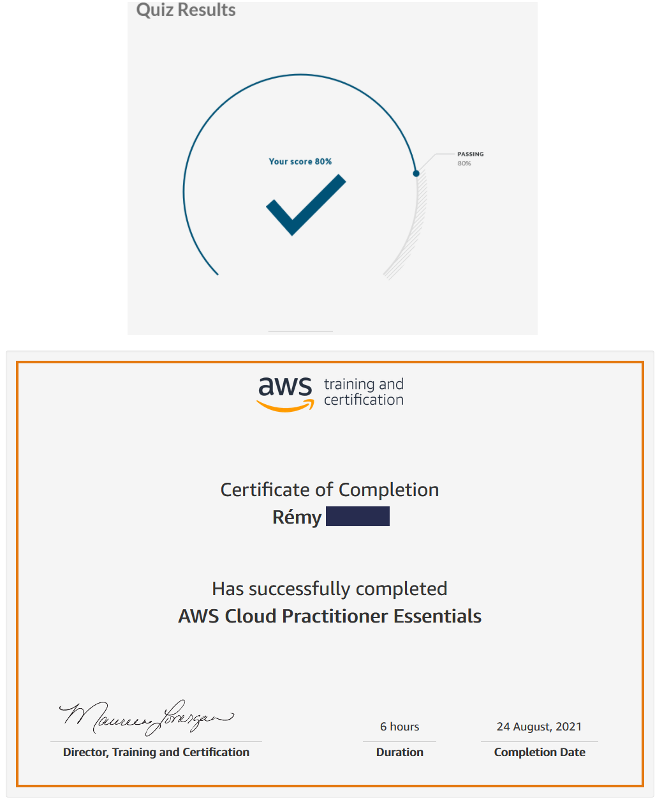
 
 <br>

---
 
 <br>

## Consignes TP Partie 1 : Introduction à AWS - une première machine linux (branche RHEL)
Back to the [ToC](#TOC) 

<br> 

**Objectif :** Se Familiariser avec Amazon Web Services et principalement le service **EC2**  

Créer une stack **LAMPS sous RHEL/Centos** avec un certificat Let's encrypt

**Ressources :** 

- **AWS**   
	- [Se connecter en ssh sur une instance Linux](https://docs.aws.amazon.com/fr_fr/AWSEC2/latest/UserGuide/AccessingInstancesLinux.html)
	- [Formation Officielle AWS en ligne (et en anglais)](https://www.aws.training/LearningLibrary?filters=classification%3A103&search=&tab=digital_courses)
	- [Formation Officielle AWS en ligne (et en anglais) Fundamentals EC2](https://www.aws.training/Details/Video?id=16382)
	- Webinar AWS France - [Bien débuter avec AWS](https://www.youtube.com/watch?v=gOeFzkiqOF4) - 45 Min 

<div style="text-align: center;"><iframe src="https://www.youtube.com/embed/gOeFzkiqOF4" width="560" height="315" frameborder="0" allowfullscreen="allowfullscreen"></iframe></div>

- **RHEL/Centos**
	- [Centos Cookbook 7](https://docs.google.com/document/d/1KIW3pEjYTJOtQtuTkQIQfrP9UA7w2DcAX_KfiTwrZAA/edit?usp=sharing)
	- [RHEL - Command List ](https://access.redhat.com/articles/1189123)

---

##  Consignes TP Partie 2 : une deuxième machine Linux - Architecture N-Tiers

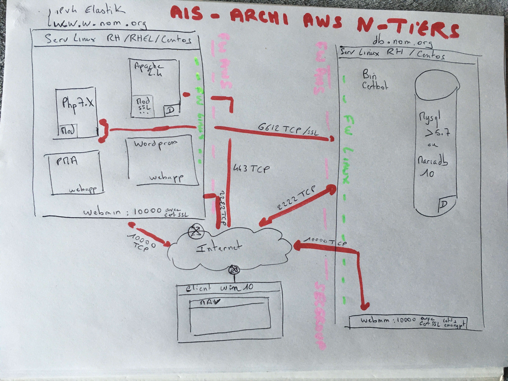

**Première Machine**:

-    Une RedHat dans une instance AWS type T2.Micro ou bien deb10 si vous galérez sur RHEL
-    Un enregistrement DNS sur un nom de domaine sur une adresse IP Elastique Fixe (si pas assez d'ip elastique, ne pas éteindre la VM pour garder la même IP)
-    Un apache avec le mod SSL et une redirection http--> https
-    Un firewall ouvert sur les ports 2222,443,10000 (pas le 80)
-    Le FW AWS ouvert sur les même ports seulement
-    PHP 7.X Installé
-    PhpMyAdmin Installé
-    Wordpress installé
-    Pas de DB
-    Let's encrypt configuré
-    Webmin installé avec le certif let's encrypt


**Deuxième Machine**!

-    Mariadb 10 ou Mysql >5.7 installé sur une VM deb10 ou RHEL
-    Le port 6612 en TCP doit servir pour communiquer si possible en SSL
-    Certbot/Let's encrypt installé sur votre FQDN qui correspond à votre IPv4
-    Pas d'IP elastic sur cette machine (pour cause de quota)
-    Webmin installé avec Let's encrypt dans sa conf
  -  Pas d'apache
-    Le FW du linux ne laisse entrer que le 6612 TCP et le 2222 TCP, ainsi que le 10000 TCP
-    Idem pour le FW AWS

**Ressources supplémentaires :**

- https://www.tecmint.com/change-default-mysql-mariadb-port-in-linux/
- https://www.tecmint.com/install-lets-encrypt-ssl-certificate-to-secure-apache-on-rhel-centos/
- https://blog.remirepo.net/post/2019/12/03/Installer-PHP-7.4-sur-CentOS-RHEL-ou-Fedora
- https://blog.microlinux.fr/selinux/
- https://www.memoinfo.fr/tutoriels-linux/configurer-lets-encrypt-apache/
- https://computingforgeeks.com/install-and-configure-phpmyadmin-on-rhel-8/
- https://mariadb.com/kb/en/configuring-mariadb-for-remote-client-access/

**Configuration VHOST apache universelle**

```bash
<VirtualHost *:80>

    ServerName domain.tld
    ServerAlias www.domain.tld

    RewriteEngine on
    RewriteCond %{HTTPS} !on
    RewriteRule (.*) https://%{HTTP_HOST}%{REQUEST_URI}

</VirtualHost>

<VirtualHost *:443>

    ServerName domain.tld
    ServerAlias www.domain.tld

    DocumentRoot /path/to/files/www.domain.tld

    <Directory /path/to/files>
        Options -Indexes
        AllowOverride all
        Order allow,deny
        allow from all
    </Directory>

    SSLEngine on
    SSLCertificateFile /etc/letsencrypt/live/domain.tld/cert.pem
    SSLCertificateKeyFile /etc/letsencrypt/live/domain.tld/privkey.pem
    SSLCertificateChainFile /etc/letsencrypt/live/domain.tld/chain.pem
    SSLProtocol all -SSLv2 -SSLv3
    SSLHonorCipherOrder on
    SSLCompression off
    SSLOptions +StrictRequire
    SSLCipherSuite ECDHE-RSA-AES128-GCM-SHA256:ECDHE-ECDSA-AES128-GCM-SHA256:ECDHE-RSA-AES256-GCM-SHA384:ECDHE-ECDSA-AES256-GCM-SHA384:DHE-RSA-AES128-GCM-SHA256:DHE-DSS-AES128-GCM-SHA256:kEDH+AESGCM:ECDHE-RSA-AES128-SHA256:ECDHE-ECDSA-AES128-SHA256:ECDHE-RSA-AES128-SHA:ECDHE-ECDSA-AES128-SHA:ECDHE-RSA-AES256-SHA384:ECDHE-ECDSA-AES256-SHA384:ECDHE-RSA-AES256-SHA:ECDHE-ECDSA-AES256-SHA:DHE-RSA-AES128-SHA256:DHE-RSA-AES128-SHA:DHE-DSS-AES128-SHA256:DHE-RSA-AES256-SHA256:DHE-DSS-AES256-SHA:DHE-RSA-AES256-SHA:AES128-GCM-SHA256:AES256-GCM-SHA384:AES128-SHA256:AES256-SHA256:AES128-SHA:AES256-SHA:AES:CAMELLIA:DES-CBC3-SHA:!aNULL:!eNULL:!EXPORT:!DES:!RC4:!MD5:!PSK:!aECDH:!EDH-DSS-DES-CBC3-SHA:!EDH-RSA-DES-CBC3-SHA:!KRB5-DES-CBC3-SHA
    Header always set Strict-Transport-Security "max-age=31536000; includeSubDomains"

    LogLevel warn
    ErrorLog ${APACHE_LOG_DIR}/www.domain.tld-error.log
    CustomLog ${APACHE_LOG_DIR}/www.domain.tld-access.log combined

</VirtualHost>
```

Enfin une liste de tutoriels provenant de la même source (merci simon!)

- https://computingforgeeks.com/change-ssh-port-centos-rhel-fedora-with-selinux/
- https://computingforgeeks.com/how-to-install-webmin-on-rhel-8-centos-8/
- https://linuxconfig.org/install-wordpress-on-redhat-8
- https://computingforgeeks.com/how-to-install-mariadb-server-on-centos-rhel-linux/
- https://computingforgeeks.com/how-to-install-php-7-4-on-centos-rhel-8/
- https://computingforgeeks.com/install-and-configure-phpmyadmin-on-rhel-8/

---

## Consignes TP Partie 3 : Cloud Hybride Distribué sous AWS et Windows Server

> Le **cloud hybride** est une solution qui associe un **cloud** privé, un ou plusieurs services **cloud** public et un logiciel propriétaire permettant la communication entre chaque service. ... Les services **cloud hybride** sont puissants, car ils offrent aux entreprises un contrôle accru sur leurs données privées.

**[Définition du cloud hybride - Citrix France](https://www.citrix.com/fr-fr/glossary/what-is-hybrid-cloud.html)**

**[Définition du cloud distribué](https://adam.hypotheses.org/1378)**

Mise en Oeuvre :

- Installer Une Machine Windows Server dans le cloud AWS (choix de l'os, taille, réseau)
- Se connecter dessus en RDP
- Installer le Rôle AD avec les bons choix DNS
- Créer un DC mono-site, mono-domaine avec une stratégie de compte minimale, users et GPO
- Installer un deuxième Windows Server dans le cloud
- Le connecter à l'AD
- Installer un client windows chez vous
- Le connecter à l'AD
- Installer un serveur LA(MP)S dans le cloud et le connecter à l'AD


**Ressources :**

[Se connecter à un windows server AWS par RDP](https://docs.aws.amazon.com/fr_fr/AWSEC2/latest/WindowsGuide/connecting_to_windows_instance.html)

Tout savoir sur les VPC
- https://aws.amazon.com/fr/vpc/faqs/
- https://docs.aws.amazon.com/fr_fr/AmazonRDS/latest/UserGuide/CHAP_Tutorials.WebServerDB.CreateVPC.html
- https://aws.amazon.com/fr/premiumsupport/knowledge-center/create-connection-vpc/

<br>

---

<br>

## TP Partie 1


<br>

Zone: ***Stockholm***


**Instance:**

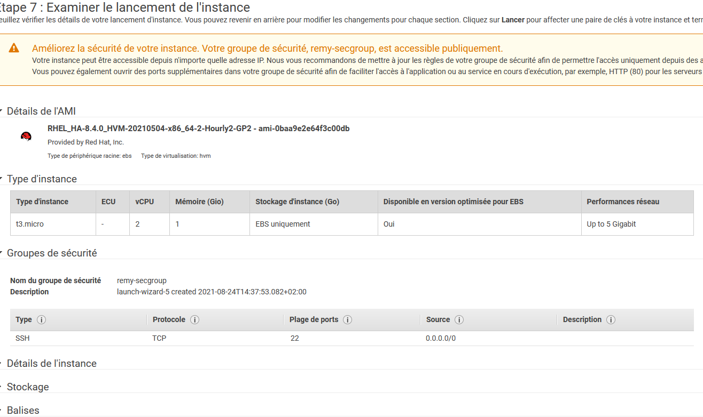

**LAMPS**

Changing the root password and creating a dedicated user

```terminal {title="bash"}
sudo su -
passwd root
useradd remy
passwd remy
usermod -aG wheel remy
su remy - 
```

System update, et installation des utilitaires

```terminal {title="bash"}
sudo dnf update -y
sudo dnf install -y zip unzip samba openssl curl git wget bash-completion net-tools yum-utils
```

Install `Apache2` and `PHP`. \
The DB (`MariaDB`) will be on another instance

```terminal {title="bash"}
sudo dnf install -y httpd
sudo dnf install -y mod_ssl
sudo systemctl enable httpd.service
sudo systemctl start httpd.service
sudo dnf install -y php
```

Creating a DNS entry for the certificate
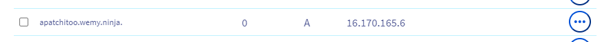


Adding rules to the AWS secgroup 
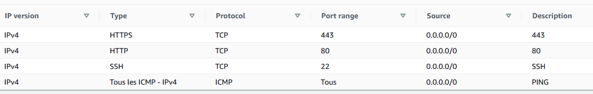

default RHEL Apache2 page
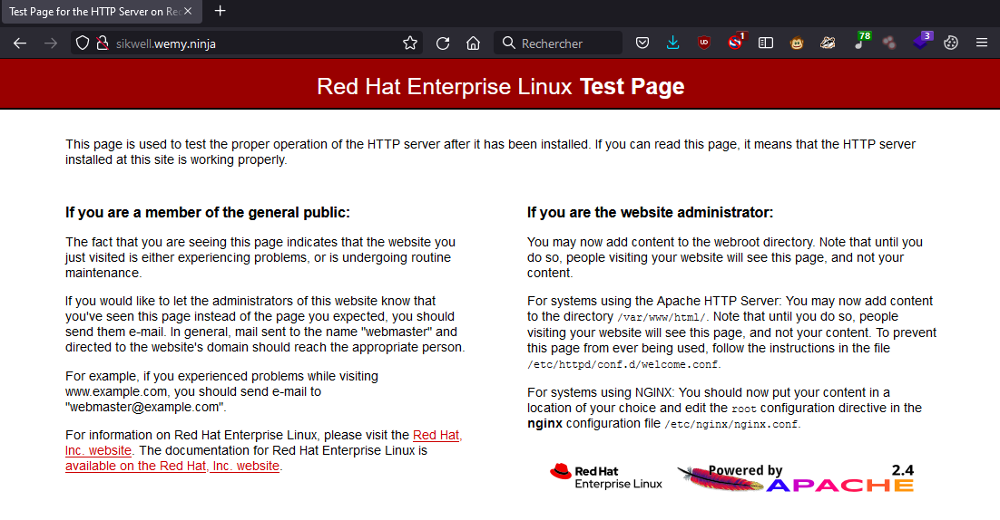

To generate a certificate we need a vhost. Cerbot can create one itself but I'll do it manually.
```terminal {title="bash"}
sudo vi /etc/httpd/conf.d/lamps.conf
```

```bash
<VirtualHost *:80>
   #ServerName www.exemple.com
   RewriteEngine On
   RewriteCond %{HTTPS} off
   RewriteRule ^(.*)$ https://%{HTTP_HOST}$1 [R=301,L]
</VirtualHost>

<IfModule mod_ssl.c>
    <VirtualHost *:443>
    #ServerName www.exemple.com
    DocumentRoot /var/www/html/
    <directory /var/www/html/>
        Require all granted
        AllowOverride All
        Options FollowSymLinks MultiViews
        SetEnv HOME /var/www/html/
        SetEnv HTTP_HOME /var/www/html/
        <IfModule mod_headers.c>
        Header Always set Strict-Transport-Security "max-age=631138519; includeSubDomains"
        #Header set Content-Security-Policy: frame-ancestors 'none'

        Header unset Content-Security-Policy
        Header add Content-Security-Policy "default-src 'self'"
        Header unset X-Content-Security-Policy
        Header add X-Content-Security-Policy "default-src 'self'"
        Header unset X-WebKit-CSP
        Header add X-WebKit-CSP "default-src 'self'"

        Header set X-Content-Type-Options "nosniff"
        Header set X-XSS-Protection "1; mode=block"
        Header set X-Frame-Options "DENY"

        Header set X-Frame-Options: DENY
        </IfModule>
    </directory>
    SSLEngine on
    SSLCertificateFile  /etc/letsencrypt/live/apatchitoo.wemy.ninja/privkey.pem
    SSLCertificateKeyFile  /etc/letsencrypt/live/apatchitoo.wemy.ninja/privkey.pem
    SSLProtocol             all -SSLv2 -SSLv3 -TLSv1 -TLSv1.1
    SSLCipherSuite          ECDHE-ECDSA-AES128-GCM-SHA256:ECDHE-RSA-AES128-GCM-SHA256:ECDHE-ECDSA-AES256-GCM-SHA384:ECDHE-RSA-AES256-GCM-SHA384:ECDHE-ECDSA-CHACHA20-POLY1305:ECDHE-RSA-CHACHA20-POLY1305:DHE-RSA-AES128-GCM-SHA256:DHE-RSA-AES256-GCM-SHA384
    SSLHonorCipherOrder     off
   </VirtualHost>
</IfModule>
```

**Let's encrypt** :  
https://certbot.eff.org/lets-encrypt/centosrhel8-apache \
https://www.cyberithub.com/how-to-install-lets-encrypt-certbot-on-rhel-centos-8/

```terminal {title="bash"}
sudo dnf install https://dl.fedoraproject.org/pub/epel/epel-release-latest-8.noarch.rpm
sudo dnf update -y
sudo dnf install -y certbot python3-certbot-apache
sudo certbot certonly --apache
```

Changing the certificate path for `SSLCertificateFile`  & `SSLCertificateKeyFile` in `/etc/httpd/conf.d/ssl.conf` \
with the one we just generated

Then restarting Apache: 
```terminal {title="bash"}
sudo systemctl restart httpd
```

There we go :  
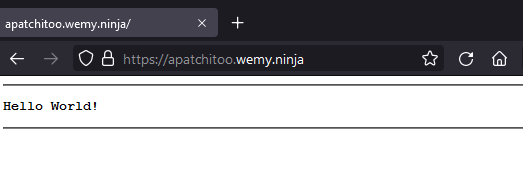


Using the Mozilla observatory (which include ssllabs tests and more), I got an A+ Score \
(This was not asked not something we had to do, and is utterly useless since we will delete everything at the end of the week, but who cares) . \

https://observatory.mozilla.org/analyze/apatchitoo.wemy.ninja

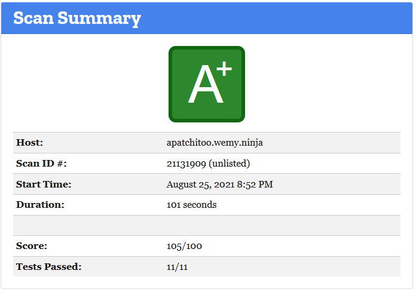

<br>

---

<br>

## TP Partie 2 : Architecture N-Tiers

Checkboxs [ ] are what we had to do, if it's crossed [X]  it's means it was completed

**First Machine**

Modifier port ssh
- 1.1) `yum install policycoreutils-python-utils -y`
- 1.2) `semanage port -a -t ssh_port_t -p tcp 2222`
- 1.3) `semanage port -m -t ssh_port_t -p tcp 2222`
- 1.4) Dans le fichier `/etc/ssh/sshd_config` :
	- Ajouter ligne `Port 2222`
- 1.5) systemctl restart sshd
   
   
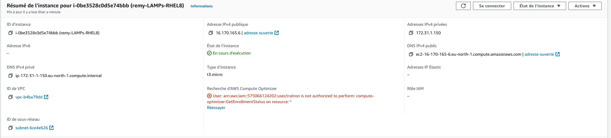

- [x] Une RedHat dans une instance AWS type T2.Micro ou bien deb10 si vous galérez sur RHEL

<br>


- [X] Un enregistrement DNS sur un nom de domaine sur une adresse IP Elastique Fixe (si pas assez d'ip elastique, ne pas éteindre la VM pour garder la même IP)

<br>


```terminal {title="bash"}
sudo dnf install -y httpd
sudo dnf install -y mod_ssl
sudo systemctl enable httpd.service
sudo systemctl start httpd.service
```

```bash
   RewriteEngine On
   RewriteCond %{HTTPS} off
   RewriteRule ^(.*)$ https://%{HTTP_HOST}$1 [R=301,L]
```

See  The vhost conf in [TP Partie 1](#TP%20Partie%201) for the complete file

- [x] Un apache avec le mod SSL et une redirection http--> https

<br>

```terminal {title="bash"}
sudo dnf -y install firewalld
sudo systemctl enable --now firewalld
sudo firewall-cmd --add-port=443/tcp --permanent
sudo firewall-cmd --add-port=2222/tcp --permanent
sudo firewall-cmd --add-port=10000/tcp --permanent
sudo firewall-cmd --reload
```
- [X] Un firewall ouvert sur les ports 2222,443,10000 (pas le 80)

<br>

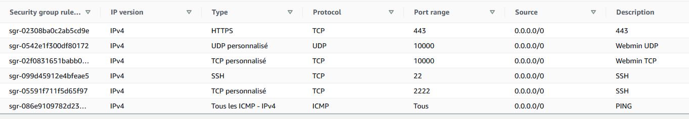
- [X] Le FW AWS ouvert sur les même ports seulement

<br>

```terminal {title="bash"}
sudo dnf install -y php

[remy@ip-172-31-1-150 ec2-user]$ php --version
PHP 7.2.24 (cli) (built: Oct 22 2019 08:28:36) ( NTS )
Copyright (c) 1997-2018 The PHP Group
Zend Engine v3.2.0, Copyright (c) 1998-2018 Zend Technologies
```
- [x] PHP 7.X Installé

<br>


https://computingforgeeks.com/install-and-configure-phpmyadmin-on-rhel-8/

```terminal {title="bash"}
sudo yum -y install php-mysqlnd
wget https://files.phpmyadmin.net/phpMyAdmin/5.1.1/phpMyAdmin-5.1.1-all-languages.tar.gz
sudo tar xvf phpMyAdmin-5.1.1-all-languages.tar.gz
sudo rm phpMyAdmin-5.1.1-all-languages.tar.gz
sudo mv phpMyAdmin-5.1.1-all-languages/ /usr/share/phpmyadmin
sudo mkdir -p /var/lib/phpmyadmin/tmp
sudo chown -R apache:apache /var/lib/phpmyadmin
sudo mkdir /etc/phpmyadmin/
sudo cp /usr/share/phpmyadmin/config.sample.inc.php  /usr/share/phpmyadmin/config.inc.php
```

https://www.motorsportdiesel.com/tools/blowfish-salt/pma/ \
`sudo vim /usr/share/phpmyadmin/config.inc.php`
for `host`, put the ip of the 2nd machine (chere the DB is)
```shell
$cfg['TempDir'] = '/var/lib/phpmyadmin/tmp';
$cfg['Servers'][$i]['host'] = '172.31.5.42:6612';
```

```terminal {title="bash"}
sudo vim /etc/httpd/conf.d/phpmyadmin.conf
```

```bash
# Apache configuration for phpMyAdmin
#Alias /phpMyAdmin /usr/share/phpmyadmin/
#Alias /phpmyadmin /usr/share/phpmyadmin/
Alias /pma /usr/share/phpmyadmin/

 
<Directory /usr/share/phpmyadmin/>
   AddDefaultCharset UTF-8
 
   <IfModule mod_authz_core.c>
     # Apache 2.4
     Require all granted
   </IfModule>
   <IfModule !mod_authz_core.c>
     # Apache 2.2
     Order Deny,Allow
     Deny from All
     Allow from 127.0.0.1
     Allow from ::1
   </IfModule>
</Directory>
```

```terminal {title="bash"}
sudo restorecon -Rv /usr/share/phpmyadmin
sudo dnf install -y php-json php-xml
sudo systemctl restart httpd
```
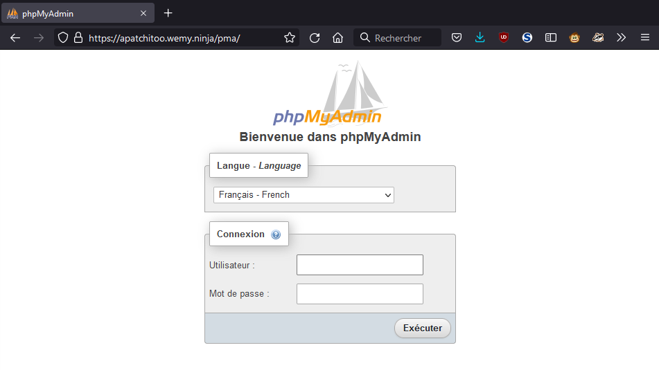

Right now I can't login because the DB is on the 2nd machine and it's not finished yet

**sur la 2eme machine**

```terminal {title="bash"}
sudo dnf install -y mariadb-server
systemctl enable mariadb
systemctl start mariadb
mysql_secure_installation
```
to change the port
```terminal {title="bash"}
vi /etc/my.cnf.d/mariadb-server.cnf
```

under `[mysqld]`: add
```bash
port = 6612
```

```terminal {title="bash"}
systemctl restart mariadb
```

login to mysql to authorize distant login, I will use the IP (not the public IP) of the 1st machine

```sql
mysql -u root -p

MariaDB [(none)]> GRANT ALL PRIVILEGES ON *.* TO 'root'@'172.31.1.150' IDENTIFIED BY 'MY_SQLROOT_PASSWORD' WITH GRANT OPTION;
Query OK, 0 rows affected (0.000 sec)

MariaDB [(none)]> flush privileges;
Query OK, 0 rows affected (0.000 sec)
```

to confirm and show what address is authorized
```sql
MariaDB [(none)]> SELECT User, Host FROM mysql.user WHERE Host <> 'localhost';
+------+--------------------------------------------+
| User | Host                                       |
+------+--------------------------------------------+
| root | 127.0.0.1                                  |
| root | 172.31.1.150                               |
| root | ::1                                        |
| root | ip-172-31-5-42.eu-north-1.compute.internal |
+------+--------------------------------------------+
```

There we go, PMA on the 1st machine connected to the MariaDB on the 2nd (we can see the server ip `172.31.5.42`)

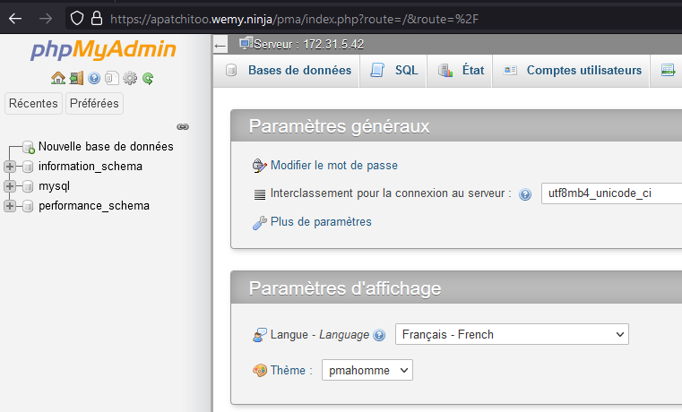

- [X] PhpMyAdmin Installé


<br>
https://linuxconfig.org/install-wordpress-on-redhat-8

login to MariaDB to create a user and DB for wordpress.

`mysql -h 172.31.5.42 -P 6612 -u root -p`

```sql
CREATE DATABASE wp_db;
CREATE USER `wp_user`@`localhost` IDENTIFIED BY 'wp_user_password';
GRANT ALL ON *.* TO `wp_user`@`localhost`;
FLUSH PRIVILEGES;
exit
```

Dowloading WP
```terminal {title="bash"}
curl https://wordpress.org/latest.tar.gz --output wordpress.tar.gz
tar xf wordpress.tar.gz
cp -r wordpress /var/www/html
chown -R apache:apache /var/www/html/wordpress
chcon -t httpd_sys_rw_content_t /var/www/html/wordpress -R
```
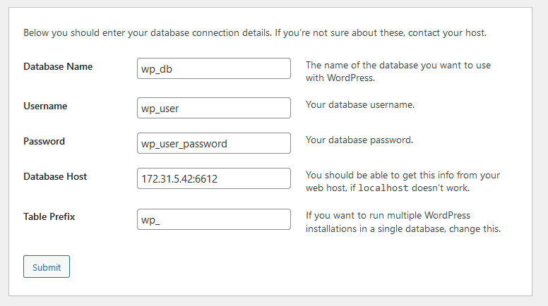

At this point, mysql crashed and would refuse to even start if any port was specified. \
No matter which port i chosed, it would always says that the port is already in use by another mysql service. \
The worpress installation is not finished but it's not really the point of this week, it's more about AWS so it's okay.
- [ ] Wordpress installé


<br>

```terminal {title="bash"}
[remy@ip-172-31-5-42 root]$ mariadb
bash: mariadb: command not found
[remy@ip-172-31-5-42 root]$ mysql
bash: mysql: command not found
[remy@ip-172-31-5-42 root]$
```
- [X] Pas de DB

<br>

```terminal {title="bash"}
sudo dnf install -y https://dl.fedoraproject.org/pub/epel/epel-release-latest-8.noarch.rpm
sudo dnf update -y
sudo dnf install -y certbot python3-certbot-apache
sudo certbot certonly --apache -d apatchitoo.wemy.ninja
```
- [X] Let's encrypt configuré

<br>

https://www.tecmint.com/install-webmin-in-rhel-8/

```terminal {title="bash"}
sudo dnf install -y wget perl perl-Net-SSLeay openssl unzip perl-Encode-Detect perl-Data-Dumper
wget https://download.webmin.com/jcameron-key.asc
sudo rpm --import jcameron-key.asc
wget https://prdownloads.sourceforge.net/webadmin/webmin-1.970-1.noarch.rpm
rpm -Uvh webmin-1.970-1.noarch.rpm
```

Webmin > Webmin Configuration > SSL Encryption : \
And change the path of the private key and certificate file

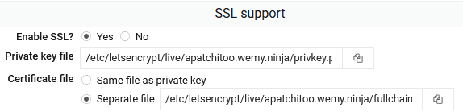

Save, then Restart webmin

Here we go, webmin with a valide certificate

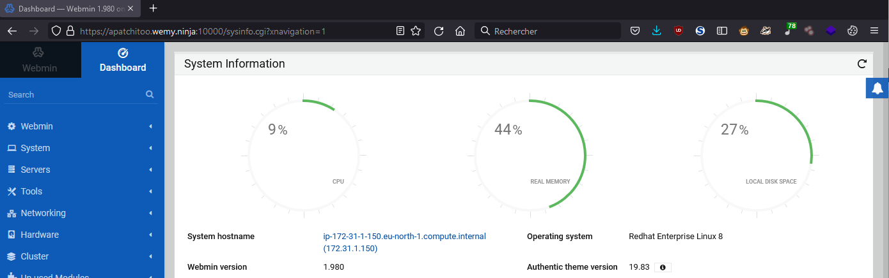
- [X] Webmin installé avec le certif let's encrypt


<br>

**Deuxième Machine**

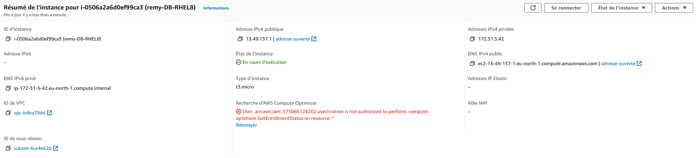

Install MariaDB en checking version : 10
```terminal {title="bash"}
sudo dnf install -y mariadb-server
systemctl enable mariadb
systemctl start mariadb
mysql_secure_installation

[root@ip-172-31-5-42 ~]# mysql --version
mysql  Ver 15.1 Distrib 10.3.28-MariaDB, for Linux (x86_64) using readline 5.1

```
- [X] Mariadb 10 ou Mysql >5.7 installé sur une VM deb10 ou RHEL

<br>

- [ ] Le port 6612 en TCP doit servir pour communiquer si possible en SSL

<br>

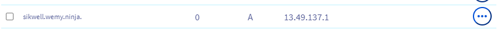
Since we can't install apache on this machine, I need to use `certonly --standalone`

```terminal {title="bash"}
[remy@ip-172-31-5-42 root]$ sudo certbot certonly --standalone -d sikwell.wemy.ninja
Saving debug log to /var/log/letsencrypt/letsencrypt.log
Requesting a certificate for sikwell.wemy.ninja

Successfully received certificate.
Certificate is saved at: /etc/letsencrypt/live/sikwell.wemy.ninja/fullchain.pem
Key is saved at:         /etc/letsencrypt/live/sikwell.wemy.ninja/privkey.pem
This certificate expires on 2021-11-23.
These files will be updated when the certificate renews.

NEXT STEPS:
- The certificate will need to be renewed before it expires. Certbot can automatically renew the certificate in the background, but you may need to take steps to enable that functionality. See https://certbot.org/renewal-setup for instructions.

- - - - - - - - - - - - - - - - - - - - - - - - - - - - - - - - - - - - - - - -
If you like Certbot, please consider supporting our work by:
 * Donating to ISRG / Let's Encrypt:   https://letsencrypt.org/donate
 * Donating to EFF:                    https://eff.org/donate-le
- - - - - - - - - - - - - - - - - - - - - - - - - - - - - - - - - - - - - - - -
[remy@ip-172-31-5-42 root]$
```
- [X] Certbot/Let's encrypt installé sur votre FQDN qui correspond à votre IPv4


<br>

- [X] Pas d'IP elastic sur cette machine (pour cause de quota)


<br>

Same thing as machine 1
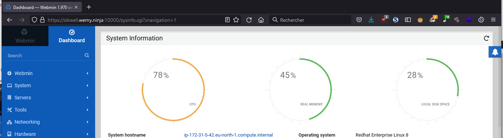
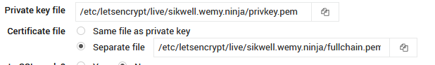
- [X] Webmin installé avec Let's encrypt dans sa conf

<br>

```terminal {title="bash"}
[root@ip-172-31-5-42 ~]# sudo systemctl status httpd
Unit httpd.service could not be found.
```
- [X] Pas d'apache

<br>

```terminal {title="bash"}
sudo dnf -y install firewalld
sudo systemctl enable --now firewalld

sudo firewall-cmd --add-port=2222/tcp --permanent
sudo firewall-cmd --add-port=6612/tcp --permanent
sudo firewall-cmd --add-port=10000/tcp --permanent

sudo firewall-cmd --reload
```
- [W] Le FW du linux ne laisse entrer que le 6612 TCP et le 2222 TCP, ainsi que le 10000 TCP

<br>

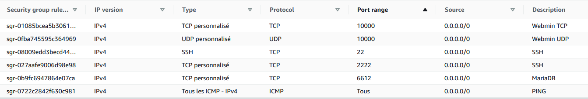
- [X] Idem pour le FW AWS


---

<br>

## TP Partie 3
Back to the [ToC](#TOC)

<br>

https://docs.aws.amazon.com/directoryservice/latest/admin-guide/ms_ad_tutorial_setup_trust_prepare_mad.html

**Mise en Oeuvre :**

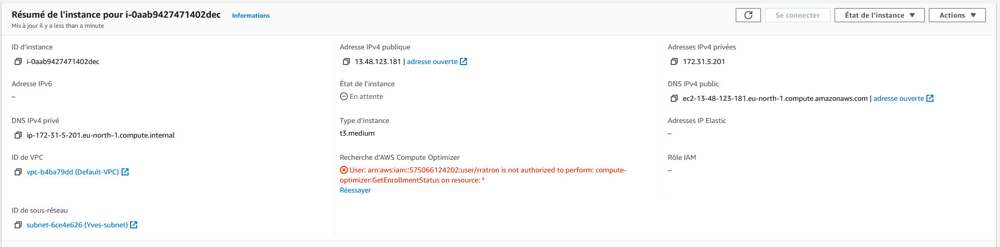

- [X] Installer Une Machine Windows Server dans le cloud AWS (choix de l'os, taille, réseau)

<br>

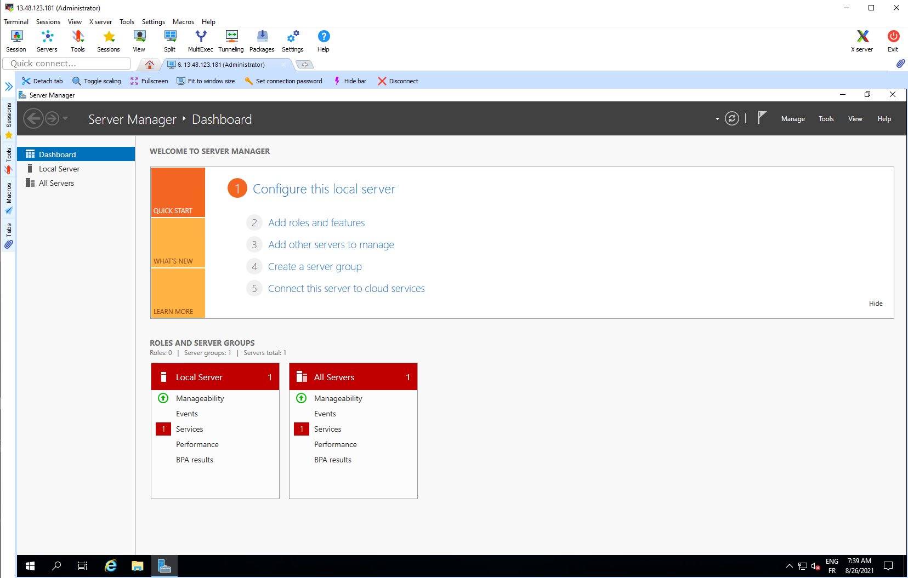
- [X] Se connecter dessus en RDP

<br>

hostame changed to **DC1** \
Updates deactivated \
IE Security for Admins only \
Network location set to private \

Add role > AD DS > add DNS (not checked by default) > install \
Promote this server > new forest > ...

DNS Console > Create a New Reverse lookup Zone \

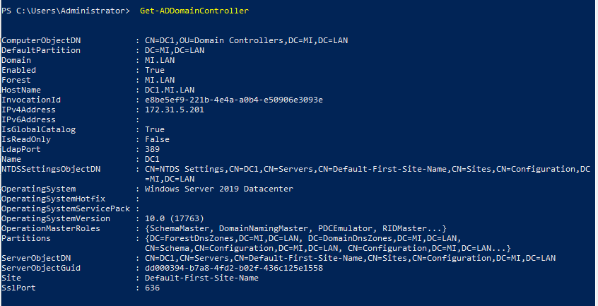
- [X] Installer le Rôle AD avec les bons choix DNS

<br>


- [x] Créer un DC mono-site, mono-domaine avec une stratégie de compte minimale, users et GPO

<br>

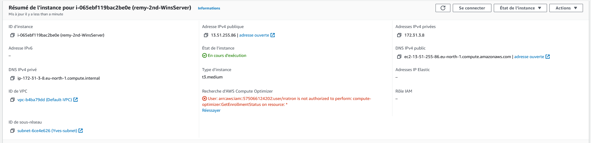
- [X] Installer un deuxième Windows Server dans le cloud

<br>

I forgot to take this screenshot

- [x] Le connecter à l'AD

<br>

- [X] Installer un client windows chez vous

<br>

To connect the client to the Domain, We need a vpn tunnel

I used this Marketplace instance

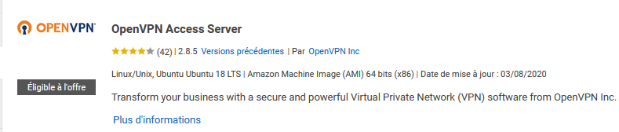

once up and running, I need to ssh to it to change the openvpn password `passwd openvpn` \
and that's it about the configuration

Now I just need to go to **`https://ipaddress:943/?src=connect`** to download the Windows client.

Run it, and lunch open VPN. 

login (user: openvpn \ pws: the one you just changed) and we're good 

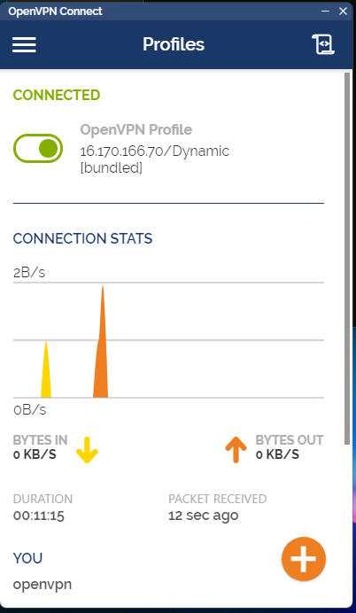

Now I need to change the DNS Server of the Openvpn NIC to my AD addrress

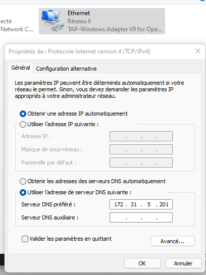

Or in the OpenVPN admin interface **`https://ipaddress:943/?src=connect`** \
Go to Configuration > VPN Settings : \
DNS Settings

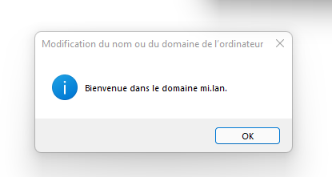

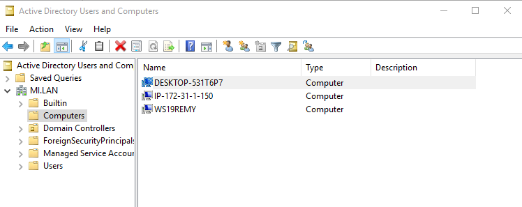

- [x] Le connecter à l'AD

<br>

using the same RHEL instance on the previous TP so I don't have to waste time to reinstall a LAMPs stack.
https://www.redhat.com/sysadmin/linux-active-directory
https://yallalabs.com/linux/how-to-join-centos-7-rhel-7-servers-to-active-directory-domain/

```terminal {title="bash"}
sudo vim /etc/sysconfig/network-scripts/ifcfg-eth0
```

```bash
DNS=137.31.0.1
DNS=137.31.5.201
```


```terminal {title="bash"}
vim /etc/resolv.conf
```

```bash
search mi.lan
nameserver 172.31.5.201
```

> other option:
> 1.    Create the `/etc/NetworkManager/conf.d/disable-resolve.conf-managing.conf` file with the following content:
> ```bash
> [main]
> dns=none
> ```
> 2.    Reboot the instance, and then populate the `/etc/resolv.conf` file manually.
> 

```terminal {title="bash"}
dnf install -y realmd sssd oddjob oddjob-mkhomedir adcli samba-common samba-common-tools krb5-workstation authselect-compat


[root@ip-172-31-1-150 ~]# realm discover mi.lan²
  type: kerberos
  realm-name: MI.LAN
  domain-name: MI.LAN
  configured: no
  server-software: active-directory
  client-software: sssd
  required-package: oddjob
  required-package: oddjob-mkhomedir
  required-package: sssd
  required-package: adcli
  required-package: samba-common-tools
mi.lan
  type: kerberos
  realm-name: MI.LAN
  domain-name: mi.lan
  configured: no
[root@ip-172-31-1-150 ~]#


realm join mi.lan -U administrator

[root@ip-172-31-1-150 ~]# realm list
MI.LAN
  type: kerberos
  realm-name: MI.LAN
  domain-name: mi.lan
  configured: kerberos-member
  server-software: active-directory
  client-software: sssd
  required-package: oddjob
  required-package: oddjob-mkhomedir
  required-package: sssd
  required-package: adcli
  required-package: samba-common-tools
  login-formats: %U@mi.lan
  login-policy: allow-realm-logins
```

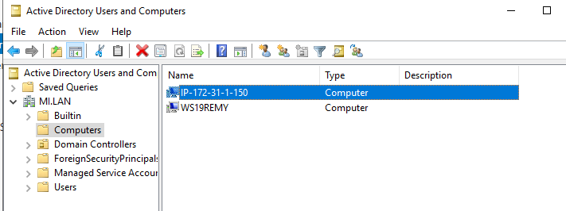

- [X] Installer un serveur LA(MP)S dans le cloud et le connecter à l'AD

<br><br>

---

<br><br>

# Azure

Semaine du 20/09/2021 au 24/09/2021

## Resources Azure

- [Authentication and verification methods are available in Azure Active Directory](https://docs.microsoft.com/en-us/azure/active-directory/authentication/concept-authentication-methods)
- [AIS2021_infos_cert_AZURE](https://docs.google.com/spreadsheets/d/1ydVZJpmC4jipdyahIwqaGPb7_P9S757GbVkb1pKPAk4/edit#gid=0)
- [Créer une machine virtuelle Windows Serveur dans Azure](https://www.toutwindows.com/azure-vm-windows/)
- [Installer une VM Lamps sous azure](https://usefulangle.com/post/326/azure-install-linux-apache-mysql-php-phpmyadmin-lamp-stack-ubuntu-18-04)
- [Créer un site web statique avec Blob Storage](https://www.antoinebernard.com/fr/heberger-un-site-statique-dans-azure-blob-storage/)
- [uploader sur son site web statique](https://www.cloudenfrancais.com/posts/2018-07-06-comment-creer-un-site-web-statique-avec-azure-blob-storage.html)
- [Mise en place d'azure file sync](https://piermick.wordpress.com/2019/02/15/mise-en-place-de-azure-file-sync/)


<br>

## Compendium Azure
Back to the [ToC](#TOC)

<br>

**Inscription Azure pour les étudiants**

Vous donne accès via [Azure Dev Tools for Teaching](https://azureforeducation.microsoft.com) et [MS365](https://office.com) avec un compte `toto@cefim.eu` avec 1 an de service gratuit.  
Nous allons créer votre compte dans le [tenant](https://www.google.com/search?q=tenant+azure+definition) (locataire cefim.eu) pour vous donner ces droits  
Attention vous aurez quand même deux comptes car il y en a un pour la certification  
_A aucun moment vous n'avez besoin de mettre votre carte bleue_


Chaîne **Youtube** de **[Stan Quastana](https://stanislas.io/)** - MS PRO : https://www.youtube.com/channel/UCuMBPlhwdtx54Qx9a_OhuMA

Certaines vidéos ont été actualisée en septembre 2021!

- Introduction à Azure (édition été 2020) - **Partie 1 - les basiques, les datacenters...** \
<div style="text-align: center;"><iframe src="https://www.youtube.com/embed/T4fCX0w4irM" width="560" height="315" frameborder="0" allowfullscreen="allowfullscreen"></iframe></div>

- Introduction à Azure (édition été 2020) - **Partie 2 - Administrer les services Azure** \
<div style="text-align: center;"><iframe src="https://www.youtube.com/embed/gkeo5e_1Wgo" width="560" height="315" frameborder="0" allowfullscreen="allowfullscreen"></iframe></div>

- Introduction à Azure (édition été 2020) - **Partie 3 - les machines virtuelles** \
<div style="text-align: center;"><iframe src="https://www.youtube.com/embed/DJDh9wDvODo" width="560" height="315" frameborder="0" allowfullscreen="allowfullscreen"></iframe></div>

- Introduction à Azure (édition été 2020) - **Partie 4 - le réseau** \
<div style="text-align: center;"><iframe src="https://www.youtube.com/embed/Js3tGZpncYo" width="560" height="315" frameborder="0" allowfullscreen="allowfullscreen"></iframe></div>

...

- Introduction à Azure (édition 2019) - **partie 6 - Les conteneurs dans Azure** \
<div style="text-align: center;"><iframe src="https://www.youtube.com/embed/mNwEWH55Guo" width="560" height="315" frameborder="0" allowfullscreen="allowfullscreen"></iframe></div>

...


**Certification MS AZ 900**

Nécessite un compte perso, gratuit et sans carte bleue, créer votre propre subscription azure pour l'entrainement.

- https://experiences.microsoft.fr/technique/cloud-infra-technique/obtenir-certification-microsoft-azure-2-jours/
- https://docs.microsoft.com/fr-fr/learn/paths/azure-fundamentals/
- https://docs.microsoft.com/fr-fr/learn/certifications/azure-fundamentals


**RESSOURCES**

**VPN S2S DANS AZURE**

- https://docs.microsoft.com/fr-fr/azure/vpn-gateway/vpn-gateway-howto-site-to-site-resource-manager-portal
- https://docs.microsoft.com/fr-fr/azure/vpn-gateway/vpn-gateway-activeactive-rm-powershell
- https://azure.microsoft.com/fr-fr/pricing/details/vpn-gateway/
- https://www.scom2k7.com/creating-a-site-to-site-azure-vpn-with-pfsense/


**AZURE AD CONNECT & TENANT**

**AZ AD Connect et Office365**

- https://rdr-it.com/azure-ad-connect-installation/
- https://akril.net/installer-et-configurer-azure-ad-connect-pour-synchroniser-votre-ad-avec-office-365/

**AZ AD**

<div style="text-align: center;"><iframe width="560" height="315" src="https://www.youtube.com/embed/tzNODH51fV4" title="YouTube video player" frameborder="0" allow="accelerometer; autoplay; clipboard-write; encrypted-media; gyroscope; picture-in-picture" allowfullscreen></iframe></div>

- https://docs.microsoft.com/fr-fr/azure/active-directory/fundamentals/five-steps-to-full-application-integration-with-azure-ad
- https://www.it-connect.fr/installation-et-configuration-dazure-ad-connect/

<br>

---

> Disclairer: \
> Contrary to AWS, this week was more about using the plateforme itself and all the different services it has to offer. \
> So it will stay very basic/not very technical

<br>

## Jour 1

Visionage 
- [Introduction à Azure (édition été 2020) - Partie 1 - les basiques, les datacenters...](https://www.youtube.com/watch?v=T4fCX0w4irM)
- [Introduction à Azure (édition été 2020) - Partie 2 - Administrer les services Azure](https://www.youtube.com/watch?v=gkeo5e_1Wgo)
- [Introduction à Azure (édition été 2020) - Partie 3 - les machines virtuelles](https://www.youtube.com/watch?v=DJDh9wDvODo)

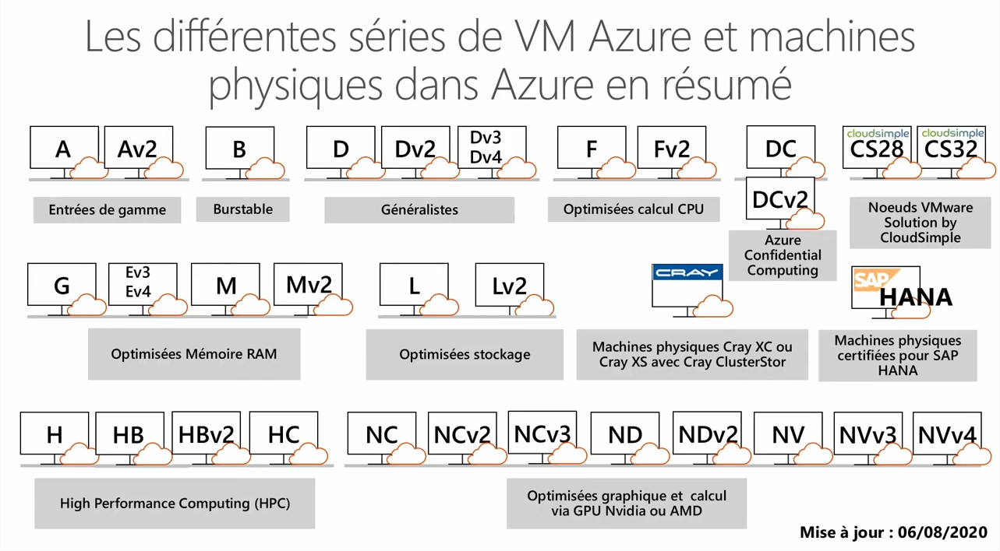

- [Introduction à Azure (édition été 2020) - Partie 4 - le réseau](https://www.youtube.com/watch?v=Js3tGZpncYo)

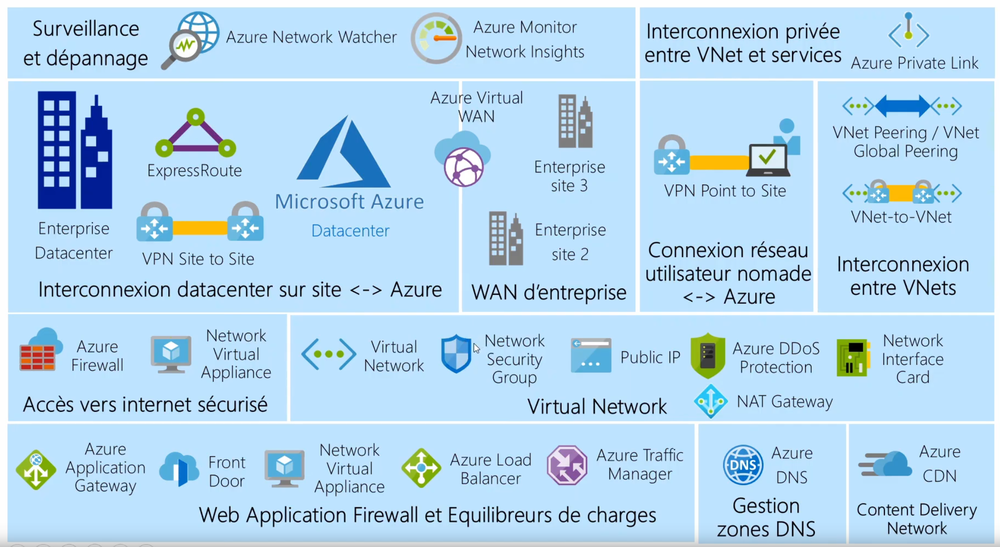

<br>

## Jour 2

Parcour Azure Fundamentals (Microsoft Learn)  \
https://docs.microsoft.com/en-Us/learn/paths/azure-fundamentals/

puis Setup de notre compte étudiant en passant pas la plateforme [Azure Dev Tools for Teaching](https://azureforeducation.microsoft.com)

<br>

## Jour 3

### Create & Connect to a Windows VM


>**Devoir 1 :** \
> Create an Azure VM running WinServer 2022 and setup a single and simple html page using IIS

Menu > Virtual Machine > Create > Virtual Machine

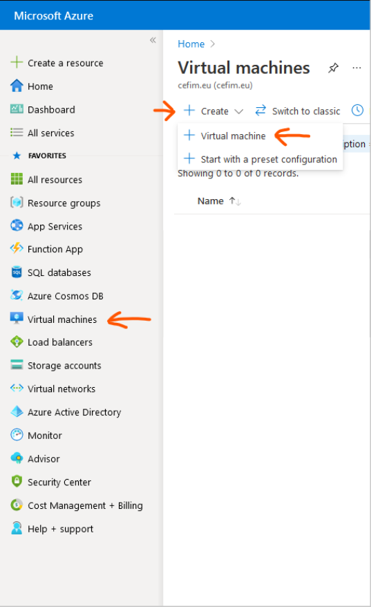

TAB: Basics

Détails du projet
- Subsciption : Azure pour les étudiants
- Resource group : Create new > RG_AIS2021_Remy

Detail de l'instantce
- Virtual machine name : remy-Win22-1
- Region : (Europe) France Central
- Image : Windows Server 2022 Datacenter - Gen2
- Size : Standard_B2s

Administrator account
- Username : administrateur 
- password : ``P@$$W0RD``

Inbound port rules
- Public inbound ports : Allow selected ports
- Select inbound ports : RDP (3389)

TAB: Disks \
Diskoptions:
- OS disk type : Standard SSD
- Ecryption type : Default

TAB: Networking \
Network interface:
- Virtual network : RG_AIS2021_Remy-nvet
- subnet : default
- public IP : new remy-win22-1-ip


TAB: Tag
 os : win2022
 owner RemyAIS2021
 type : www
 
TAB: Reveiw + create

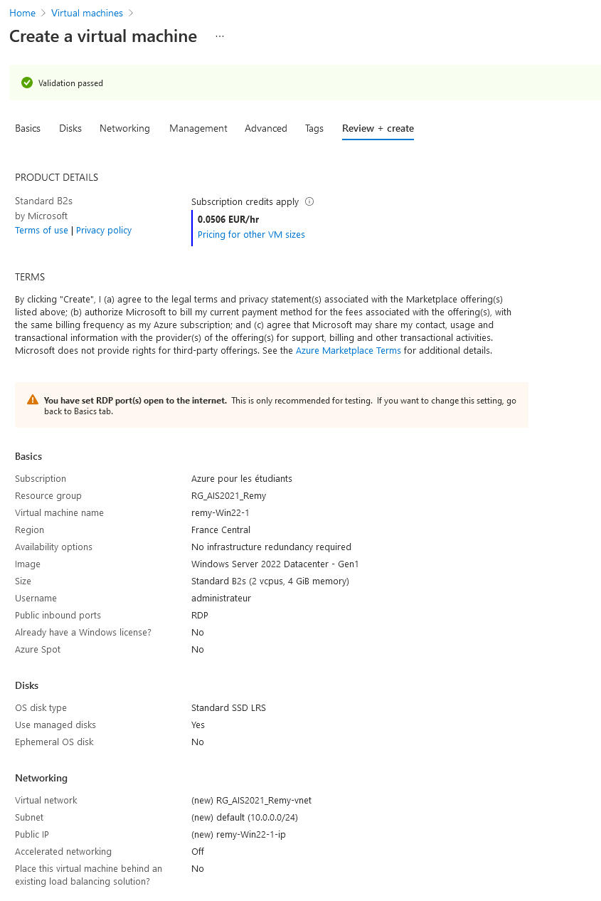


then Create


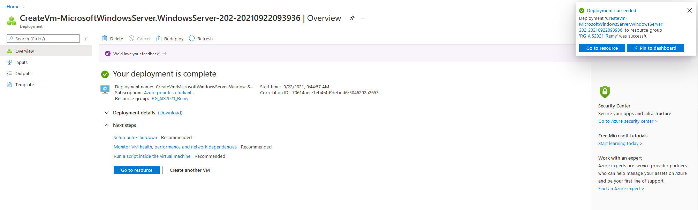

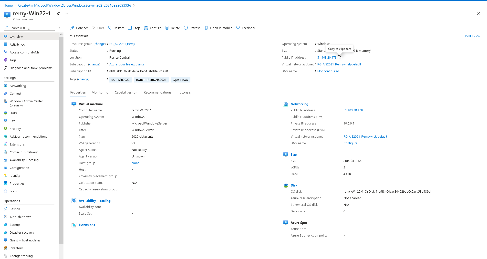

Record A Done

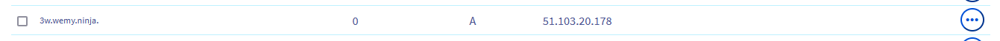


**Connecting to the VM via RDP**

On the Connect tab on the VM : Download RDP File

and I'm changing it to use the fqdn and not the IP

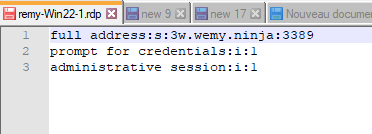

Here we go, connected

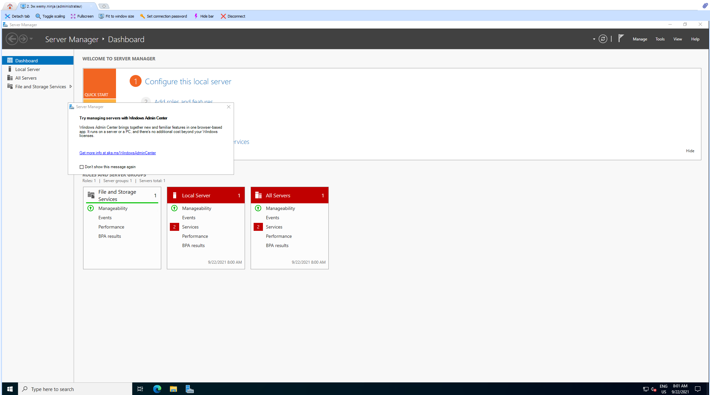

```html
<p style="text-align:center;font-size:1500px;">400</p> 
```

Done: \
Preuve rendu : 

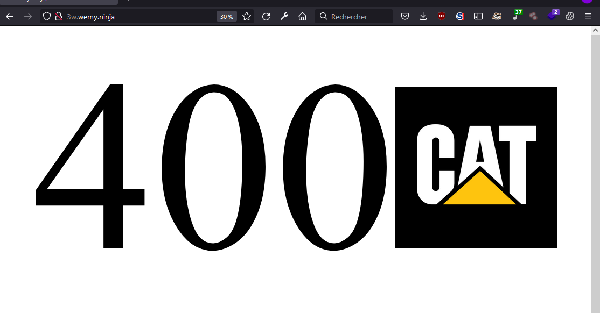

<br>

### Create & Connect to a Linux VM

>**Devoir 2** : \
>Create an Azure VM running Ubuntu server and setup a single and simple html page using Apache

it's basically the same thing as the windows VM but but with Ubuntu Server

VM created
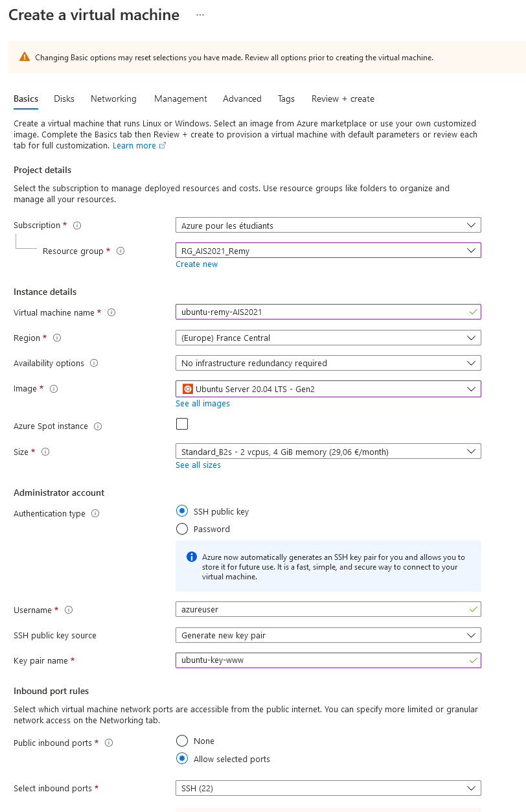

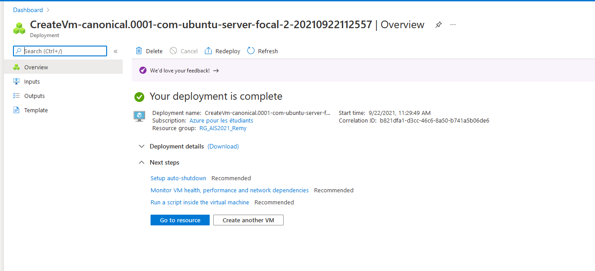

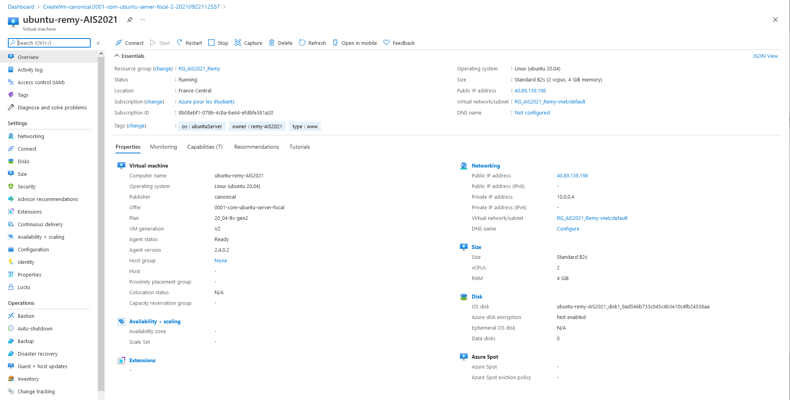


Record A 

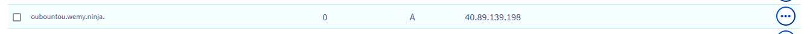

connected

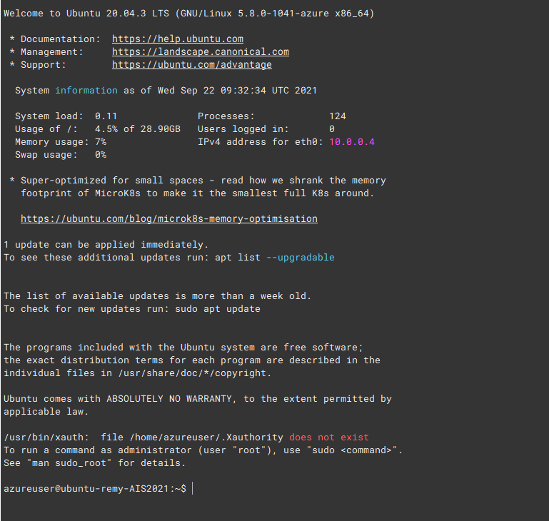

simple page
```
<p style="text-align:center;font-size:500px;">400</p>
```

Done : 
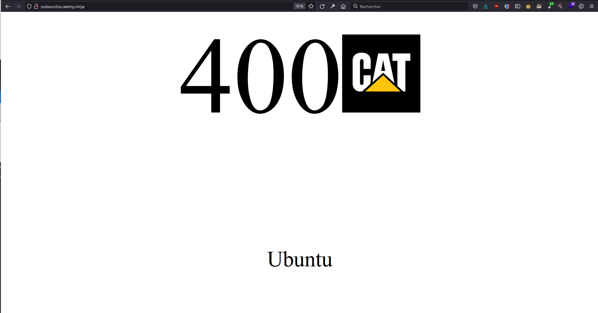


<br>

### Blob Storage

<br>

>**Devoir 3 :** \
> Again, seting up a simple html page but this time using the Blob storage

.
- https://www.antoinebernard.com/fr/heberger-un-site-statique-dans-azure-blob-storage/
- https://www.cloudenfrancais.com/posts/2018-07-06-comment-creer-un-site-web-statique-avec-azure-blob-storage.html


Create a resource > Storage Account

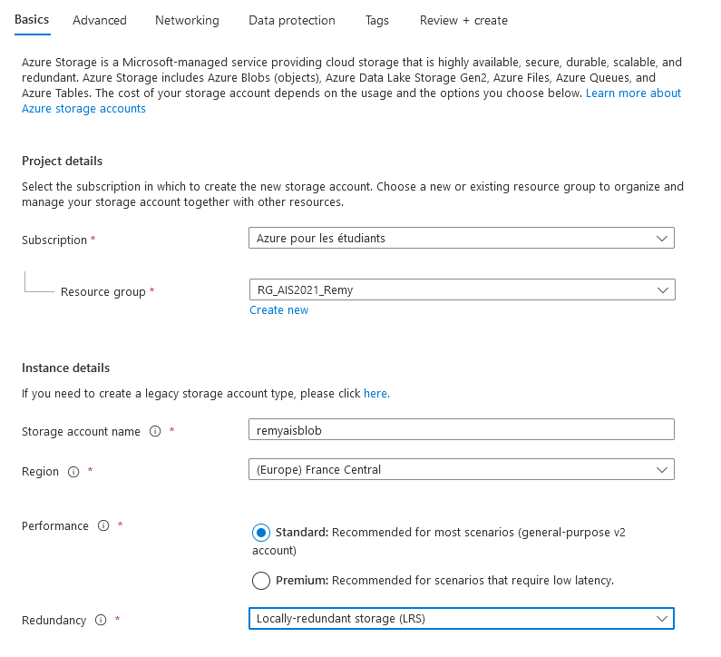

I can leave the everything by default

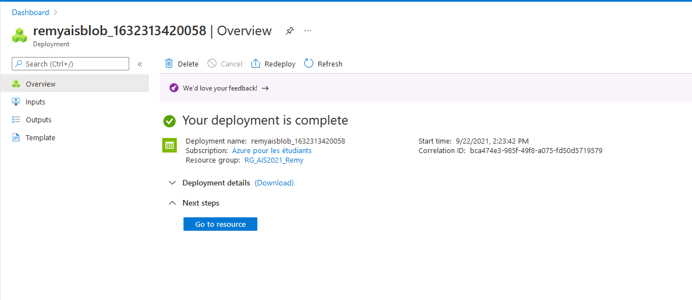


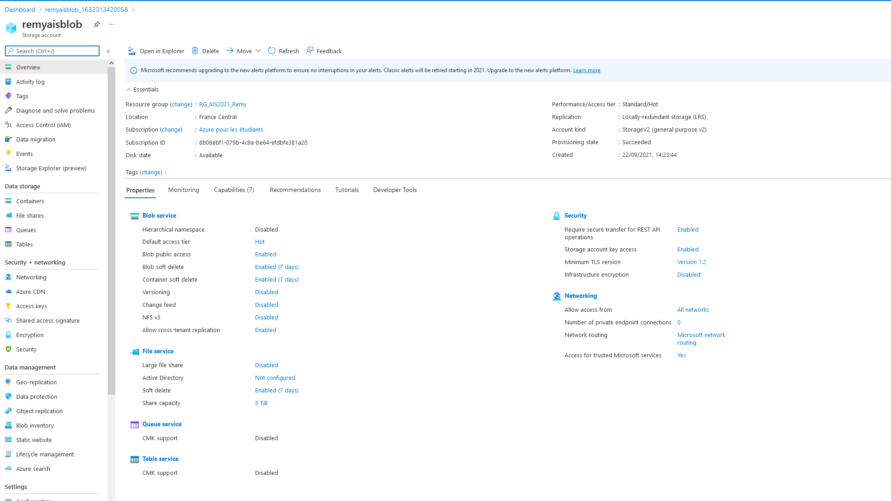


on the left side : Static Website

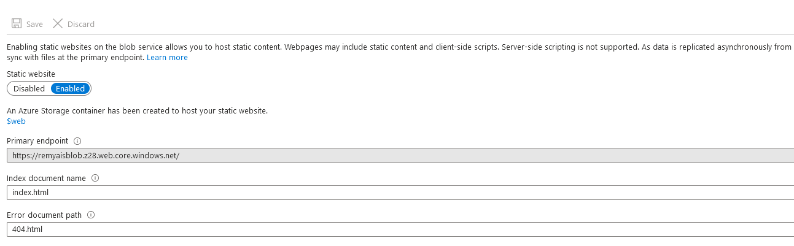

on the left, on Containers, `$web` was created

go in there and add you files `index.html`

and it's done, it's that simple

https://remyaisblob.z28.web.core.windows.net/


<br>

## Jour 4 

### Azure File Sync


>**Devoir 4 :** \
> Sting up Azure File Synchronisation between Azure and a local VM


https://piermick.wordpress.com/2019/02/15/mise-en-place-de-azure-file-sync/

Create a Resource > Storage account

chose a Resource group and a name. This is just for testing so averityhing else can stay default.

Review + Create > Create 

Go to resources

 On the left under Data Storage > File shares 
 
 Clic `+ File Share` > chose a name and Create 
 
 
 
Then Create a resource : Search for Azure File Sync > Create

Chose a Resource group and a name > Create

Go to resource > `+ Sync group` \
Chose a name, select the storage acount ans the Azure file share creted earlier and Create


Now on to my local Server 2022 VM

First, installing the `AzureRM` powershell module

```powershell
Install-Module AzureRM 
```

or
```powershell
Install-Module az
```


Download the Storage Sync Agent : https://www.microsoft.com/en-us/download/details.aspx?id=57159

execte the .msi

The installation process is pretty straight forward, the only thing I changed was not to use Microsoft Update, 

the client will launch itself

Signing in and chosing my Resource group and storage


Register


Back on Azure in my storage sync service

on the left : Sync groups

clic on the group and `Add server endpoint`

select the server you've just registered and set a it's Path 


back on the storage account > file share

and I can see the Public shared directory here


<br>

###  AD dans le cloud avec VPN S2S
Back to the [ToC](#TOC)

<br>

>**Devoir 5 :** \
> In an Auzre VM running WinServer 2022, set up an AD and a VPN S2S to connect a local client (on-premise)

First creatin a New WinServer2022 VM in Azure


Adding the AD DS role


<br>

### Azure VPN Site 2 Site with pfSense


https://www.scom2k7.com/creating-a-site-to-site-azure-vpn-with-pfsense/ \
https://vmarena.com/how-to-create-a-site-to-site-s2s-vpn-in-azure/

Since i'm behind my ISP's router, I will need to put my pfsense VM in a DMZ (even though it worked without DMZ for some people).

**pfSense**  needs 2 Network adapters :


- NIC1 : **Bridged** for the WAN (will be **em0**)
- NIC2 : **Host-only** for the LAN (will be **em1**)
	- I used Workstation Virtual Network Editor to change the host-only subnet and disable local DHCP.


This way, all VMs will need to be on Host-only

Here's a little plan of the whole finished thing: <sup>not sure if everything is placed correctly but here it is</sup> 


<br> 

 Now to the actual VPN connexion
 
Since I just created a VM in a clean environement, the Vnet is already created.

1. I need to create a Virtual Network Gateway (ms [doc](https://docs.microsoft.com/en-us/azure/vpn-gateway/tutorial-site-to-site-portal))

	New Local Network Gateway  with my local network subnet

	Search **Virtual Network Gateway** > **Create New** 

	

	Give it a relevent **Name** \
	**Gateway Type**: VPN \
	**SKU**: Basic (⚠ The lower the SKU is, the longer it will take to setup. With the basic SKU it's gonna take around 40-45 min) \
	**Gen 1** \
	**Virtual Network**: one was created automatically \
	**Public IP address name**: something relevent too

	***review + create***

	

	> Carefull: The creation job will take a long time.  \
	> If you chose the Basic SKU it will take around 40 to 45 min to complete. \
	> With a higher SKU it can be cut down to just 10-15 min but it's not cheap.


2. Once created, I need to create a **Local Network Gateway**

	Same thing: Search **Local Network Gateway** > **Create New**
	
	**in IP address** : you need tu put you own public IP (I like to use https://icanhazip.com : `curl icanhazip.com`) \
	**Address space** : your local network

	

	

	Once created (the LNG): look on the left **Connection** > **Add**

	**Name**: something relevent \
	**Virtual network gateway**: The one we created ealier \
	**Local network gateway**: it's locked, I can't chose anything but since we're adding a connection UNDER it's menu it's normal. \
	**Shaked Key** : Anything you want, but keep it somewhere, we'll need it for pfSense

	

3. Next step is on pfSense: 

	Go in **VPN** : **IPSec** 

	> disclaimer: This is the only settings I changed just to make it works. It's not the best thing to do, but il'll just delete everything at the en of the way so wth.

	**Key Exchange Version**: Auto \
	**Remote gateway**: The IP tha was given by azure after creating the **virtual network gateway** \
	**Pre-Shared Key**: The one you choosed in the previous step \
	**Ecryption Algorithm** : AES / 256 bits / SHA256 / 2 (1024bits)
	**Lifetime** : 10800

	**Save**

4. Now on the phase 2 : \
	***Remote Network*** : 10.0.0.0/16 (its the one that was created automaticaly when creating VM) \
	**Encryption Algorithm**: Only Check AES and set it to 256 Bits \
	**Hash algorithm**: checkonly SHA1 

	**Save & apply** 
	
	

	**Firewell** > **Rules** \
	IPSec tabs: \
	**New rule**: any any any
	
	

	**Status** > **IPSec**

	the connection should be established

	

	And I can ping the resources on azure no problem and there's DNS resolution

	

Since I want my local VM to join the AD on the VM in Azure  (not AzureAD, we'll do that tomorrow), I'll change the DNS setting of the Vnet

So in the **Virtual network** : Under **Setting** > **DNS Servers **

I set the IP of the VM with the AD


Now if I go to my local client VM, I can see that the address of the DNS server is my AD, nice


 
 Now I can join the domain.


<br>

## Jour 5

###  TP final - AzureAD & Azure AD Connect

First step, Local VM, WinSrv2022 with AD DS role


https://www.it-connect.fr/installation-et-configuration-dazure-ad-connect/


https://www.microsoft.com/en-us/download/details.aspx?id=47594


https://docs.microsoft.com/en-us/azure/active-directory/hybrid/reference-connect-tls-enforcement

```powershell
If (-Not (Test-Path 'HKLM:\SOFTWARE\WOW6432Node\Microsoft\.NETFramework\v4.0.30319'))
{
    New-Item 'HKLM:\SOFTWARE\WOW6432Node\Microsoft\.NETFramework\v4.0.30319' -Force | Out-Null
}
New-ItemProperty -Path 'HKLM:\SOFTWARE\WOW6432Node\Microsoft\.NETFramework\v4.0.30319' -Name 'SystemDefaultTlsVersions' -Value '1' -PropertyType 'DWord' -Force | Out-Null
New-ItemProperty -Path 'HKLM:\SOFTWARE\WOW6432Node\Microsoft\.NETFramework\v4.0.30319' -Name 'SchUseStrongCrypto' -Value '1' -PropertyType 'DWord' -Force | Out-Null

If (-Not (Test-Path 'HKLM:\SOFTWARE\Microsoft\.NETFramework\v4.0.30319'))
{
    New-Item 'HKLM:\SOFTWARE\Microsoft\.NETFramework\v4.0.30319' -Force | Out-Null
}
New-ItemProperty -Path 'HKLM:\SOFTWARE\Microsoft\.NETFramework\v4.0.30319' -Name 'SystemDefaultTlsVersions' -Value '1' -PropertyType 'DWord' -Force | Out-Null
New-ItemProperty -Path 'HKLM:\SOFTWARE\Microsoft\.NETFramework\v4.0.30319' -Name 'SchUseStrongCrypto' -Value '1' -PropertyType 'DWord' -Force | Out-Null

If (-Not (Test-Path 'HKLM:\SYSTEM\CurrentControlSet\Control\SecurityProviders\SCHANNEL\Protocols\TLS 1.2\Server'))
{
    New-Item 'HKLM:\SYSTEM\CurrentControlSet\Control\SecurityProviders\SCHANNEL\Protocols\TLS 1.2\Server' -Force | Out-Null
}
New-ItemProperty -Path 'HKLM:\SYSTEM\CurrentControlSet\Control\SecurityProviders\SCHANNEL\Protocols\TLS 1.2\Server' -Name 'Enabled' -Value '1' -PropertyType 'DWord' -Force | Out-Null
New-ItemProperty -Path 'HKLM:\SYSTEM\CurrentControlSet\Control\SecurityProviders\SCHANNEL\Protocols\TLS 1.2\Server' -Name 'DisabledByDefault' -Value '0' -PropertyType 'DWord' -Force | Out-Null

If (-Not (Test-Path 'HKLM:\SYSTEM\CurrentControlSet\Control\SecurityProviders\SCHANNEL\Protocols\TLS 1.2\Client'))
{
    New-Item 'HKLM:\SYSTEM\CurrentControlSet\Control\SecurityProviders\SCHANNEL\Protocols\TLS 1.2\Client' -Force | Out-Null
}
New-ItemProperty -Path 'HKLM:\SYSTEM\CurrentControlSet\Control\SecurityProviders\SCHANNEL\Protocols\TLS 1.2\Client' -Name 'Enabled' -Value '1' -PropertyType 'DWord' -Force | Out-Null
New-ItemProperty -Path 'HKLM:\SYSTEM\CurrentControlSet\Control\SecurityProviders\SCHANNEL\Protocols\TLS 1.2\Client' -Name 'DisabledByDefault' -Value '0' -PropertyType 'DWord' -Force | Out-Null

Write-Host 'TLS 1.2 has been enabled. You must restart the Windows Server for the changes to take affect.' -ForegroundColor Cyan
```


At this point werealised that unfortunately we could not go any further.

Since we are all under the same tenant our account doesn't have the right to do this :(

even if we did, we all used the same script and csv to import a fes users so there would probably have been a conflict with the synced users

<br>


New directives: Do what we want to discorver the others Azure services.

Since I had a free voucher to pass the AZ-900 certification, I instead choosed to continue and finish the [Microsoft Learn Azure Fundamentals](https://docs.microsoft.com/en-Us/learn/paths/azure-fundamentals/) course.

I also tried some of the free practice mock exams : 
- https://www.examtopics.com/exams/microsoft/az-900/view/3/
- https://www.itexams.com/exam/AZ-900?

<br>

---

