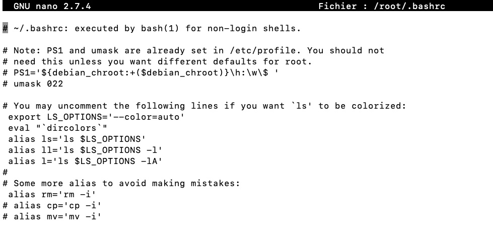
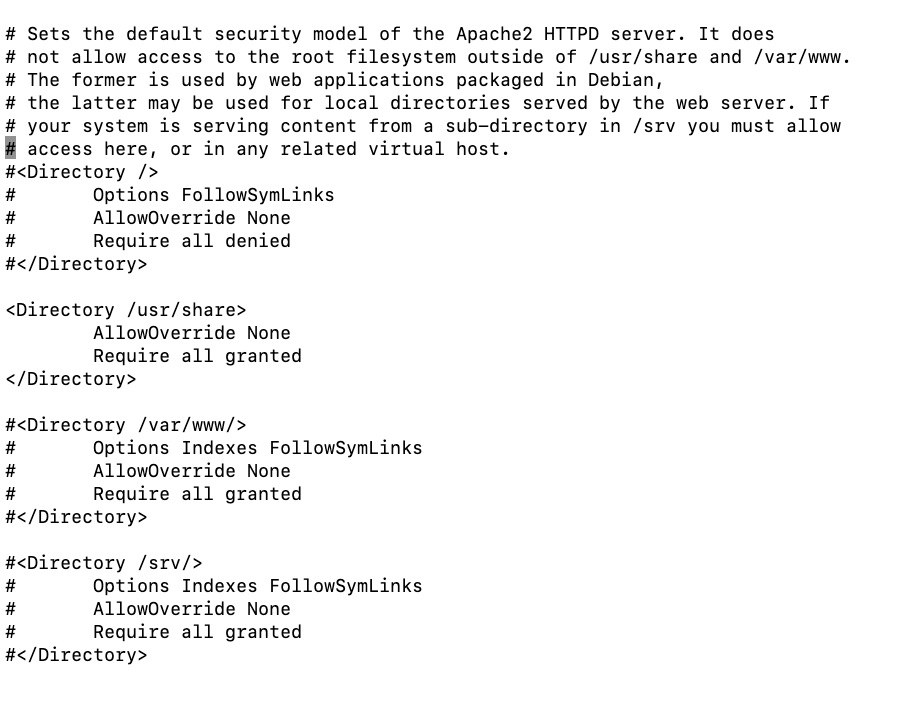
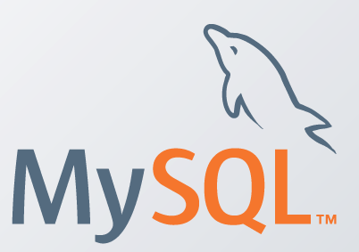
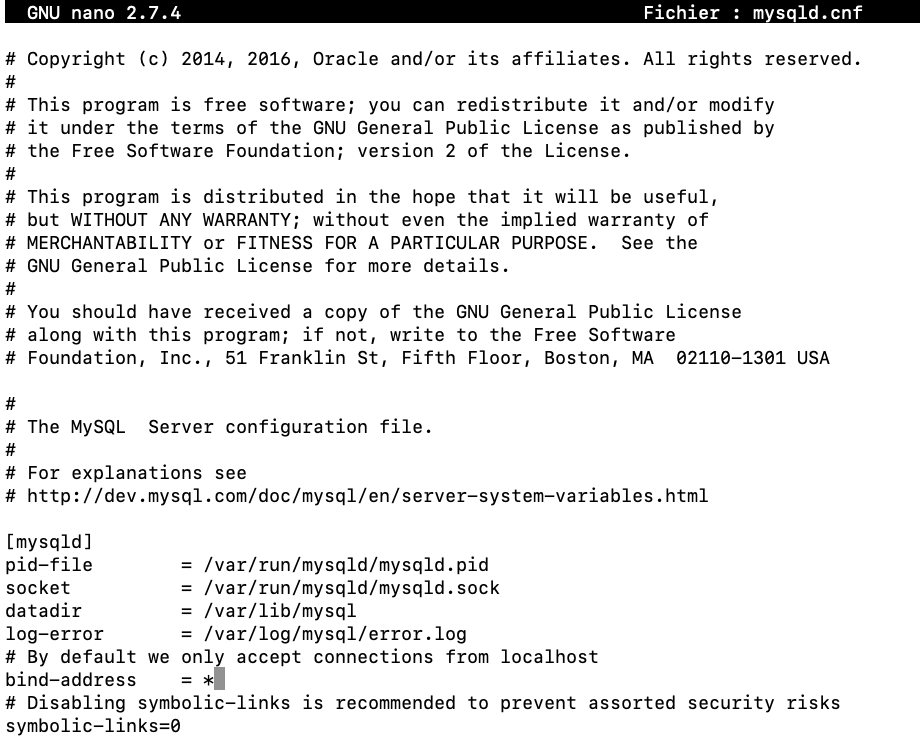
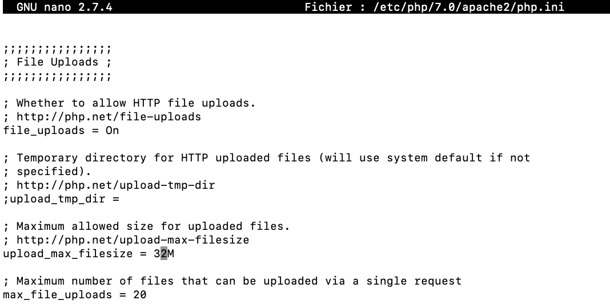
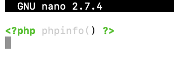
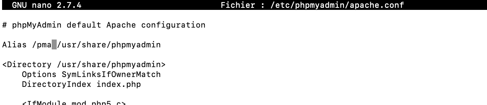
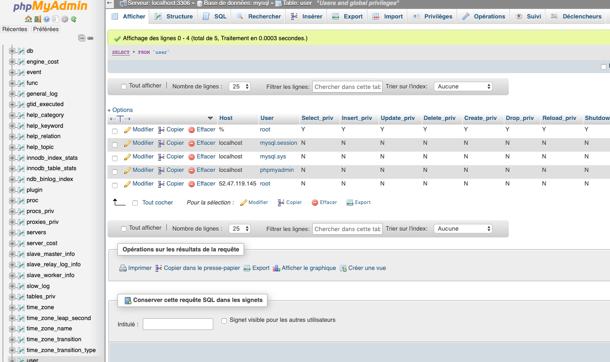
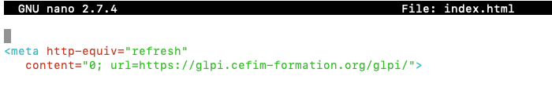

// LAMPS COOKBOOK


aller dans le home de root
```bash
cd /root
```
editer les prefs du compte root pour le bashrc

décommenter les lignes 9 à 13 et la 16


```bash
nano .bashrc
```
je me déconnecte et me reconnecte 
```bash
exit
sudo su
cd /root
```
je vérifie la disponibilité de l'alias l
```bash
l
```
edition de la configuration réseau si besoin
```bash
nano /etc/network/interfaces
```
  
je mets mon système à jour
```bash
apt update
apt upgrade -y
```
j'installe les utilitaires usuels du système
```bash
apt install nmap zip dnsutils net-tools tzdata lynx curl git screen locate ncdu
```
 je télécharge la dernière version de webmin
```bash
wget http://prdownloads.sourceforge.net/webadmin/webmin_1.941_all.deb
```
 installation du paquet en local
```bash
dpkg -i webmin_1.941_all.deb 
```
 je fini l'install via apt car dpkg a communiqué à apt les 4 bibliothèques manquantes
```bash
apt -f install
```

définir le mot de passe de root pour entre autre webmin si besoin
```bash
passwd root
```
  
je vérifie l'heure
```bash
date
```
config du fuseau
```bash
dpkg-reconfigure tzdata
```
création user
```bash
adduser user
```
création en mode user du dossier www et d’un index dans `/home/user/`  
débrayage temporaire en mode user pour la création
```bash
su user
mkdir /home/user/www
nano /home/user/www/index.html
exit
```
  
 changement récursif de propriétaire et c'est apache le nouveau proprio
```bash
chown -R www-data:www-data /home/user/www
usermod -a -G www-data user
```
changement récursif des droits pour le dossier www pour ftp et samba
```bash
chmod -R 775 /home/user/www
```

---


install d'apache 2.4
```bash
apt install apache2
```
activation du module SSL
```bash
a2enmod ssl
a2ensite default-ssl
```
relancer le service ( systemctl status apache2)
```bash
systemctl restart apache2
```
activation des modules populaires
```bash
a2enmod rewrite
systemctl restart apache2
```
  
Installation de let’s encrypt/certbot
```bash
cd /root
wget https://dl.eff.org/certbot-auto
chmod a+x certbot-auto
./certbot-auto
```

configuration apache ultime -> thesite.conf, un seul fichier
```bash
nano /etc/apache2/sites-available/thesite.conf
```
  
```bash
<VirtualHost *:80>
    ServerName machine.cefim-formation.org
    #ServerAlias www.domain.tld
    RewriteEngine on
    RewriteCond %{HTTPS} !on
    RewriteRule (.*) https://%{HTTP_HOST}%{REQUEST_URI}
  
</VirtualHost>
  
<VirtualHost *:443>
  
    ServerName machine.cefim-formation.org
    #ServerAlias www.domain.tld
  
    DocumentRoot /home/user/www/
  
    <Directory /home/user/www>
    Options -Indexes
    AllowOverride all
    Order allow,deny
    allow from all
    </Directory>
  
    SSLEngine on
    SSLCertificateFile /etc/letsencrypt/live/machine.cefim-formation.org/cert.pem
    SSLCertificateKeyFile /etc/letsencrypt/live/machine.cefim-formation.org/privkey.pem
    SSLCertificateChainFile /etc/letsencrypt/live/machine.cefim-formation.org/chain.pem
    SSLProtocol all -SSLv2 -SSLv3
    SSLHonorCipherOrder on
    SSLCompression off
    SSLOptions +StrictRequire
    SSLCipherSuite ECDHE-RSA-AES128-GCM-SHA256:ECDHE-ECDSA-AES128-GCM-SHA256:ECDHE-RSA-AES256-GCM-SHA384:ECDHE-ECDSA-AES256-GCM-SHA384:DHE-RSA-AES128-GCM-SHA256:DHE-DSS-AES128-GCM-SHA256:kEDH+AESGCM:ECDHE-RSA-AES128-SHA256:ECDHE-ECDSA-AES128-SHA256:ECDHE-RSA-AES128-SHA:ECDHE-ECDSA-AES128-SHA:ECDHE-RSA-AES256-SHA384:ECDHE-ECDSA-AES256-SHA384:ECDHE-RSA-AES256-SHA:ECDHE-ECDSA-AES256-SHA:DHE-RSA-AES128-SHA256:DHE-RSA-AES128-SHA:DHE-DSS-AES128-SHA256:DHE-RSA-AES256-SHA256:DHE-DSS-AES256-SHA:DHE-RSA-AES256-SHA:AES128-GCM-SHA256:AES256-GCM-SHA384:AES128-SHA256:AES256-SHA256:AES128-SHA:AES256-SHA:AES:CAMELLIA:DES-CBC3-SHA:!aNULL:!eNULL:!EXPORT:!DES:!RC4:!MD5:!PSK:!aECDH:!EDH-DSS-DES-CBC3-SHA:!EDH-RSA-DES-CBC3-SHA:!KRB5-DES-CBC3-SHA
    Header always set Strict-Transport-Security "max-age=31536000; includeSubDomains"
  
    LogLevel warn
    ErrorLog ${APACHE_LOG_DIR}/machine.cefim-formation.org-error.log
    CustomLog ${APACHE_LOG_DIR}/machine.cefim-formation.org-access.log combined
  
</VirtualHost>
```
modification du fichier de base de la conf apache , commentez la section  `/var/www`   
comme sur l’image ci-dessous ainsi que la section /
```bash
nano /etc/apache2/apache2.conf
```

```bash
a2enmod headers
a2ensite thesite
a2dissite default-ssl
a2dissite 000-default 
a2dissite 000-default-le-ssl
  
systemctl restart apache2
```  
  


installation de mysql en lieu et place de maria
```bash
echo -e "deb http://repo.mysql.com/apt/debian/ stretch mysql-5.7\ndeb-src http://repo.mysql.com/apt/debian/ stretch mysql-5.7" > /etc/apt/sources.list.d/mysql.list
  
wget -O /tmp/RPM-GPG-KEY-mysql [https://repo.mysql.com/RPM-GPG-KEY-mysql](https://repo.mysql.com/RPM-GPG-KEY-mysql)

apt-key add /tmp/RPM-GPG-KEY-mysql
apt update
apt install mysql-server
```
  
edition du fichier de configuration mysql pour binder toutes les IF(interfaces réseaux)
```bash
nano /etc/mysql/mysql.conf.d/mysqld.cnf
```


L’opération ci-dessus qui décroit le niveau de sécurité n’est à faire que si vous avez besoin d’un accès externe sur la base type MysqlWorkBench

relance des services
```bash
systemctl restart mysql
```
#test de mysql en cli
```bash
mysql -u root -p
```
  
installation php7
```bash
apt install php
```
edition du fichier php.ini pour modifier le upload max
```bash
nano /etc/php/7.0/apache2/php.ini
```

```bash
systemctl restart apache
```
  
création d’un fichier test dans `/home/user/www/`

nommé `test.php` avec le compte user
```bash
su user
nano /home/user/www/test.php 
```
 
```bash
exit
```
lancer un navigateur sur https://votreip/test.php
 
installation des mods php souvent utilisées par les cms et/ou les webabb
```bash
apt install php-curl php-gd php-mcrypt php-zip php-apcu php-xml php-ldap
systemctl restart apache2
```

install de PMA
```bash
apt install phpmyadmin
```
changement de l’alias



configuration des droits pour root dans mysql/pma



- flush privileges dans l’onglet SQL de l’interface de PMA 

Installation GLPI

[https://pixelabs.fr/installation-et-configuration-de-glpi-debian-9/](https://pixelabs.fr/installation-et-configuration-de-glpi-debian-9/)

en mode rapide
```bash
cd /home/user/www
wget https://github.com/glpi-project/glpi/releases/download/9.4.6/glpi-9.4.6.tgz
tar zxvf glpi-9.4.6.tgz 
apt install php-imap php-xmlrpc php-cas
systemctl restart apache2
chown -R www-data:www-data /home/user/www
```  

installation de glpi par le navigateur

création du user glpi et de la base via PMA avec les privilèges à recharger

A la fin de l’installation de glpi
```bash
rm /home/user/www/glpi/install/install.php
```  

création d’une redirection dans /home/user/www/index.html

autre méthode : modification du document root dans the site.conf
```bash
nano /home/user/www/index.html
```
  



Installation de FTPS
Configuration de IPTABLES
Configuration de Fail2Ban

---

BACKUP
  
Script de sauvegarde des bases de données

Le but est de créer une tâche automatique qui compresse en zip le dossier #contenant les bases et qui le sauve dans un dossier à la date du jour
```bash
cd /root
touch backup.sh
chmod +x backup.sh
nano backup.sh  
``` 

```bash
#!/bin/bash
#Script de backup auto de la base et du www pour le site user
#V1.0 par t.cherrier juin 2020
clear
echo Compression :
 zip -rq /home/user/$(date +%Y%m%d%H%M)_backup-fichier_www.zip  /home/user/www
echo dump de la base
mysqldump -u root -pdadfba16 --databases user > /home/user/$(date +%Y-%m-%d-%H.%M.%S).sql
echo Terminé
```  

Pour automatiser ce script :
```bash
crontab -e
```
et rajouter la ligne
```bash
*/15 * * * * /root/backup.sh**
```