 
# //Linux CookBook

---
   
### PLAN DE FORMATION

L’OS GNU/Linux
- Historique
- Branches & Distro
- GUI
- Culture Linux
- Installation d’un Debian

**Configuration VM**
- Installation en mode texte
- Les commandes de bases du CLI
- Le système de fichiers
- Gestion des users & des droits
- Gestion des compressions et des archives
- Tâches Cron
- Scripts Bash
- Installation d’Apache (service,mods,vhost,ssl,php)
- Installation de services réseau (ssh,ftps,samba)
- Installation de Mysql
- Installation d’un Centos

**Configuration VM**
- Installation en mode texte
- Les commandes de bases du CLI
- Le système de fichiers
- Gestion des users & des droits
- Gestion des compressions et des archives
- Tâches Cron
- Scripts Bash
- Installation d’Apache (service,mods,vhost,ssl,php)
- Installation de services réseau (ssh,ftps,samba)
- Installation de Mysql

---

### Travaux pratiques
(dernière demi-journée) :Création Ex-nihilo d’un VM portable LAMPS

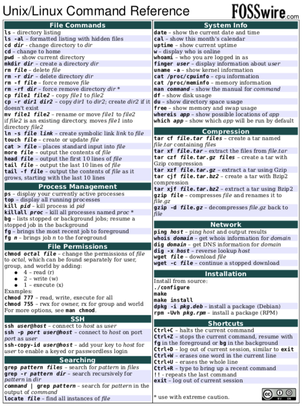

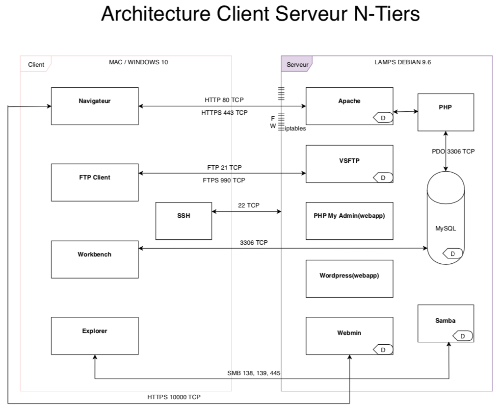

  
<br>

---

<br>
 
// DEBIAN COOKBOOK

---

aller dans le `home` de root

```bash
cd /root
```

editer les prefs du compte root pour le bashrc

```bash
nano .bashrc
```

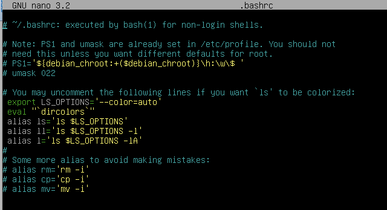

je me déconnecte et me reconnecte 

```bash
exit
cd /root
```

je vérifie la disponibilité de l'alias l
```bash
l
```
j'installe les utilitaires usuels du système

```bash
apt update
apt upgrade
apt install ssh
```
on peut désormais se connecter en ssh via un user et debrayer via la commande su - (oui su avec le tiret, important pour le path)

```bash
apt install nmap zip dnsutils net-tools tzdata lynx locate ncdu sudo curl git screen
```

je télécharge la dernière version de webmin
```bash
wget http://prdownloads.sourceforge.net/webadmin/webmin_1.941_all.deb
```
installation du paquet en local
```bash
dpkg -i webmin_1.941_all.deb 
```
je fini l'install via apt car dpkg à échangé avec apt les 4 bibliothèques manquantes
```bash
apt -f install
```
installation de samba pour le partage windows
```bash
apt install winbind samba
cd /etc/
```
je. vérifie et modifie au cas ou les dns
```bash
nano resolv.conf
```
je change le nom de ma machine dans le fichier hosts et le fichier hostname
```bash
nano hosts
nano hostname
```
je modifie la ligne de résolution hosts pour ajouter wins dans nsswitch
```bash
nano nsswitch.conf 
```
je vérifie l'heure
```bash
date
```
config du fuseau
```bash
dpkg-reconfigure tzdata
```
  

install d'apache 2.4
```bash
apt install apache2
```
activation du module SSL
```bash
a2enmod ssl
a2ensite default-ssl
```
relancer le service ( systemctl restart apache2)
```bash
service apache2 restart
```
génération du certificat auto signé pour 10 ans
```bash
openssl req $@ -new -x509 -days 3560 -nodes -out /etc/apache2/apache.pem -keyout /etc/apache2/apache.pem
```
activation des modules populaires
```bash
a2enmod rewrite
```
  
écriture du nouveau certificat ssl dans la conf apache
```bash
cd sites-available/

nano default-ssl.conf 
```
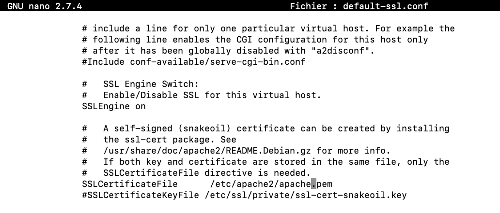

```bash
service apache2 restart
```

changement du documentroot et redirection
```bash
nano /etc/apache2/sites-available/000-default.conf
```
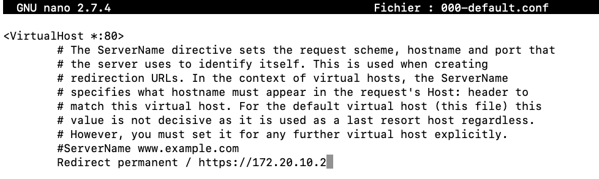

```bash
nano /etc/apache2/sites-available/default-ssl.conf 
```
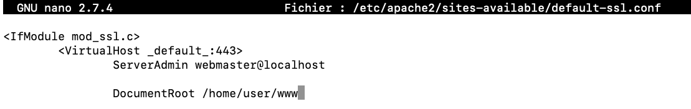

```bash
nano /etc/apache2/apache2.conf
```
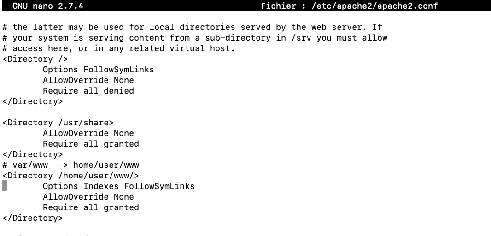

```bash
service apache2 restart
```  

création en mode user du dossier www et d’un index dans /home/user/

débrayage temporaire en mode user pour la création
```bash
su user

mkdir /home/user/www

nano /home/user/www/index.html

su
```
  
changement récursif de propriétaire et c'est apache le nouveau proprio
```bash
chown -R www-data:www-data /home/user/www

usermod -a -G www-data user
```
changement récursif des droits pour le dossier www pour ftp et samba

```bash
chmod -R 775 /home/user/www
```

installation de mysql 5.7 en lieu et place de maria
```bash
echo -e "deb http://repo.mysql.com/apt/debian/ stretch mysql-5.7\ndeb-src http://repo.mysql.com/apt/debian/ stretch mysql-5.7" > /etc/apt/sources.list.d/mysql.list

wget -O /tmp/RPM-GPG-KEY-mysql [https://repo.mysql.com/RPM-GPG-KEY-mysql](https://repo.mysql.com/RPM-GPG-KEY-mysql)

apt-key add /tmp/RPM-GPG-KEY-mysql
apt update
apt install mysql-server
```
ou bien installation de mysql 8
```bash
wget https://repo.mysql.com//mysql-apt-config_0.8.13-1_all.deb
dpkg -i mysql-apt-config_0.8.13-1_all.deb
apt update
apt -y install mysql-server
```

edition du fichier de configuration mysql pour binder toutes les IF
```bash
/etc/mysql
nmap 127.0.0.1
nmap 192.168.30.120
cd mysql.conf.d/
nano mysqld.cnf 
```
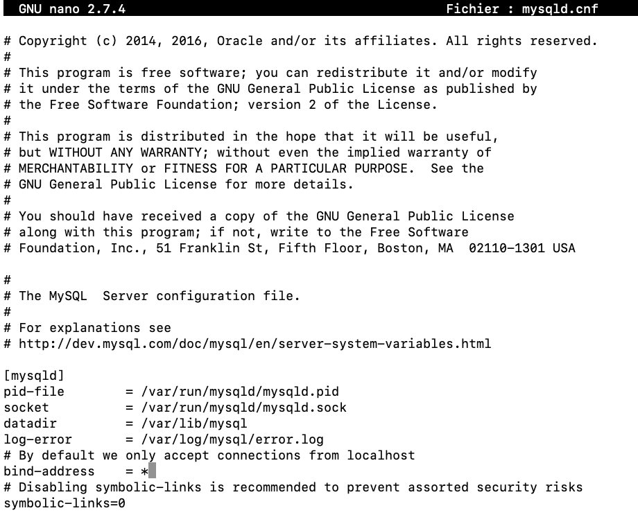

relance des services
```bash
service mysql restart
```
test de mysql en cli
```bash
mysql -u root -p
 
nmap 192.168.1.14
```
  
installation php7
```bash
   apt install php
```

edition du fichier php.ini pour modifier le upload max
```bash
nano /etc/php/7.0/apache2/php.ini
```
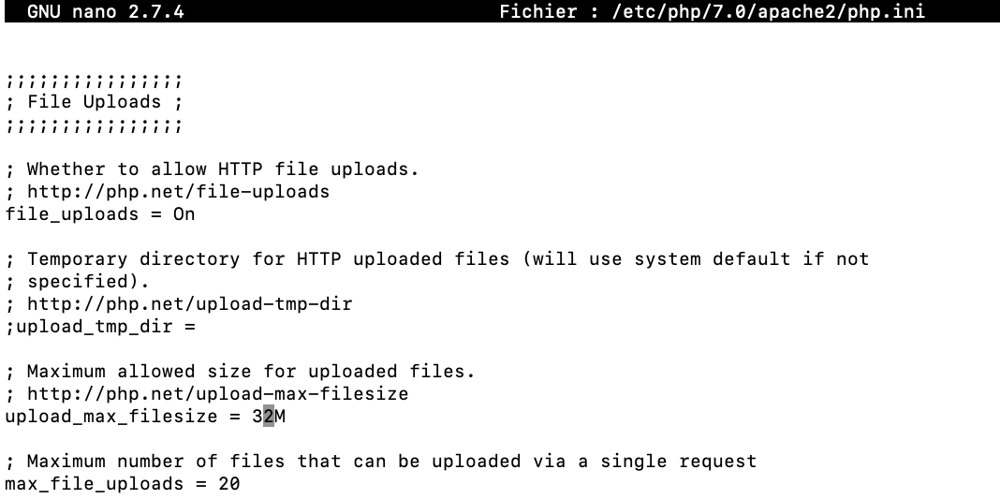

```bash
service apache2 restart
```
création d’un fichier test dans /home/user/www/

nommé `test.php` avec le compte user
```bash
su user

nano /home/user/www/test.php
```
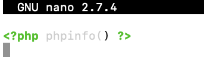

lancer un navigateur sur https://votreip/test.php

#installation des mods php souvent utilisées par les cms
```bash
apt install php-curl php-gd php-mcrypt php-zip php-apcu php-xml php-ldap

service apache2 restart
``` 

installation de binutils pour le dev
```bash
apt install composer
apt install curl
apt install git
apt install screen
```
tuto screen : https://doc.ubuntu-fr.org/screen

break & fun time
```bash
apt install bsdgames
cd /usr/games
l
./hangman
```

install de PMA
```bash
apt install phpmyadmin
```
changement de l’alias

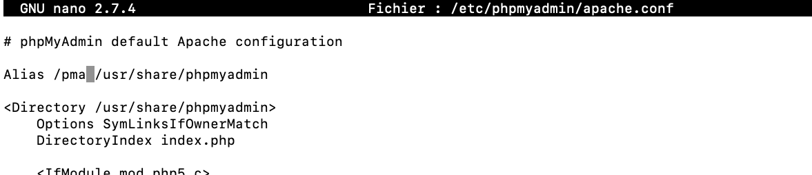

  
```bash
nano /etc/phpmyadmin/apache.conf

service apache2 restart
```
  

changement des droits root avec `%`

  

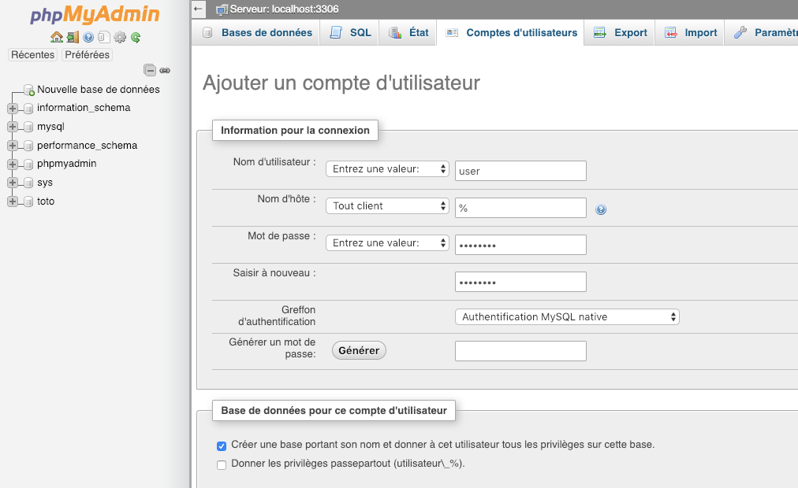

```sql
#CREATE [USER](https://172.20.10.2/pma/url.php?url=https://dev.mysql.com/doc/refman/5.5/en/information-functions.html#function_user) 'user'@'%' IDENTIFIED WITH mysql_native_password AS '***';GRANT USAGE ON *.* TO 'user'@'%' REQUIRE NONE WITH MAX_QUERIES_PER_HOUR 0 MAX_CONNECTIONS_PER_HOUR 0 MAX_UPDATES_PER_HOUR 0 MAX_USER_CONNECTIONS 0;CREATE DATABASE IF NOT EXISTS `user`;GRANT ALL PRIVILEGES ON `user`.* TO 'user'@'%';
```
  
install du service ftp 
 
```bash
apt install vsftpd

cp /etc/vsftpd.conf /etc/vsftpd.bak

rm /etc/vsftpd.conf
```
configuration du service avec chrootage et passv et ssl
```bash
nano /etc/vsftpd.conf 
```
 Example config file /etc/vsftpd.conf

```bash
#
# The default compiled in settings are fairly paranoid. This sample file
# loosens things up a bit, to make the ftp daemon more usable.
# Please see vsftpd.conf.5 for all compiled in defaults.
#
# READ THIS: This example file is NOT an exhaustive list of vsftpd options.
# Please read the vsftpd.conf.5 manual page to get a full idea of vsftpd's
# capabilities.
#
#
# Run standalone?  vsftpd can run either from an inetd or as a standalone
# daemon started from an initscript.
listen=NO
#
# This directive enables listening on IPv6 sockets. By default, listening
# on the IPv6 "any" address (::) will accept connections from both IPv6
# and IPv4 clients. It is not necessary to listen on *both* IPv4 and IPv6
# sockets. If you want that (perhaps because you want to listen on specific
# addresses) then you must run two copies of vsftpd with two configuration
# files.
listen_ipv6=YES
#
# Allow anonymous FTP? (Disabled by default).
#anonymous_enable=YES
#anon_root=/var/ftp/pub
#
# Uncomment this to allow local users to log in.
local_enable=YES
#
# Uncomment this to enable any form of FTP write command.
write_enable=YES
#
# Default umask for local users is 077. You may wish to change this to 022,
# if your users expect that (022 is used by most other ftpd's)
local_umask=022
#
# Uncomment this to allow the anonymous FTP user to upload files. This only
# has an effect if the above global write enable is activated. Also, you will
# obviously need to create a directory writable by the FTP user.
#anon_upload_enable=YES
#
# Uncomment this if you want the anonymous FTP user to be able to create
# new directories.
#anon_mkdir_write_enable=YES
#
# Activate directory messages - messages given to remote users when they
# go into a certain directory.
dirmessage_enable=YES
#
# If enabled, vsftpd will display directory listings with the time
# in  your  local  time  zone.  The default is to display GMT. The
# times returned by the MDTM FTP command are also affected by this
# option.
use_localtime=YES
#
# Activate logging of uploads/downloads.
xferlog_enable=YES
#
# Make sure PORT transfer connections originate from port 20 (ftp-data).
connect_from_port_20=YES
#
# If you want, you can arrange for uploaded anonymous files to be owned by
# a different user. Note! Using "root" for uploaded files is not
# recommended!
#chown_uploads=YES
#chown_username=whoever
#
# You may override where the log file goes if you like. The default is shown
# below.
#xferlog_file=/var/log/vsftpd.log
#
# If you want, you can have your log file in standard ftpd xferlog format.
# Note that the default log file location is /var/log/xferlog in this case.
#xferlog_std_format=YES
#
# You may change the default value for timing out an idle session.
#idle_session_timeout=600
#
# You may change the default value for timing out a data connection.
#data_connection_timeout=120
#
# It is recommended that you define on your system a unique user which the
# ftp server can use as a totally isolated and unprivileged user.
#nopriv_user=ftpsecure
#
# Enable this and the server will recognise asynchronous ABOR requests. Not
# recommended for security (the code is non-trivial). Not enabling it,
# however, may confuse older FTP clients.
#async_abor_enable=YES
#
# By default the server will pretend to allow ASCII mode but in fact ignore
# the request. Turn on the below options to have the server actually do ASCII
# mangling on files when in ASCII mode.
# Beware that on some FTP servers, ASCII support allows a denial of service
# attack (DoS) via the command "SIZE /big/file" in ASCII mode. vsftpd
# predicted this attack and has always been safe, reporting the size of the
# raw file.
# ASCII mangling is a horrible feature of the protocol.
#ascii_upload_enable=YES
#ascii_download_enable=YES
#
# You may fully customise the login banner string:
ftpd_banner=David Banner
#
# You may specify a file of disallowed anonymous e-mail addresses. Apparently
# useful for combatting certain DoS attacks.
#deny_email_enable=YES
# (default follows)
#banned_email_file=/etc/vsftpd.banned_emails
#
# You may restrict local users to their home directories.  See the FAQ for
# the possible risks in this before using chroot_local_user or
# chroot_list_enable below.
chroot_local_user=YES
#
# You may specify an explicit list of local users to chroot() to their home
# directory. If chroot_local_user is YES, then this list becomes a list of
# users to NOT chroot().
# (Warning! chroot'ing can be very dangerous. If using chroot, make sure that
# the user does not have write access to the top level directory within the
# chroot)
allow_writeable_chroot=YES
#chroot_list_enable=YES
# (default follows)
#chroot_list_file=/etc/vsftpd.chroot_list
#
# You may activate the "-R" option to the builtin ls. This is disabled by
# default to avoid remote users being able to cause excessive I/O on large
# sites. However, some broken FTP clients such as "ncftp" and "mirror" assume
# the presence of the "-R" option, so there is a strong case for enabling it.
#ls_recurse_enable=YES
#
# Customization
#
# Some of vsftpd's settings don't fit the filesystem layout by
# default.
#
# This option should be the name of a directory which is empty.  Also, the
# directory should not be writable by the ftp user. This directory is used
# as a secure chroot() jail at times vsftpd does not require filesystem
# access.
secure_chroot_dir=/var/run/vsftpd/empty
#
# This string is the name of the PAM service vsftpd will use.
pam_service_name=vsftpd
#
# This option specifies the location of the RSA certificate to use for SSL
# encrypted connections.
# Paths to your letsencrypt files
rsa_cert_file=/etc/letsencrypt/live/authpedago.cefim-formation.org/fullchain.pem
rsa_private_key_file=/etc/letsencrypt/live/authpedago.cefim-formation.org/privkey.pem
ssl_enable=YES
allow_anon_ssl=NO
  
# Options to force all communications over SSL - why would you want to
# allow clear these days? Comment them out if you don't want to force
# SSL though
force_local_data_ssl=YES
force_local_logins_ssl=YES
ssl_tlsv1=YES
ssl_sslv2=NO
ssl_sslv3=NO
  
require_ssl_reuse=NO
ssl_ciphers=HIGH
#passv mode (extended if applicable)
pasv_enable=yes
pasv_min_port=65000
pasv_max_port=65500
```
 
 ```bash
systemctl restart vsftpd 
nmap 127.0.0.1
nmap votreip
service vsftpd status
```
se connecter en ftps avec filezilla client

verifier le mode epasv (le mode nouveau extended et le port est passé)


install et config de samba

```bash  
mv /etc/samba/smb.conf /etc/samba/smb.bak
nano /etc/samba/smb.conf
```

```bash
[global]
workgroup = TSSR
netbios name = lampsform
comment = Serveur de fichier de thomas
interfaces = enp0s3
encrypt passwords = true
security = user
smb passwd file = /usr/bin/smbpasswd
passdb backend = tdbsam
obey pam restrictions = yes
  
[www]
path = /home/user/www
valid users = user
writeable = Yes
create mask = 777
directory mask = 777
```

```bash
service nmbd restart
service smbd restart
testparm
smbpasswd -a user
```
Script de sauvegarde des bases de données

Le but est de créer une tâche automatique qui compresse en zip le dossier #contenant les bases et qui le sauve dans un dossier à la date du jour
```bash
cd /root
touch backup.sh
chmod +x backup.sh
nano backup.sh  
  ```

```bash
#!/bin/bash
#Script de backup auto de la base et du www pour le site user
#V1.0 par t.cherrier janvier 2019
clear
echo Compression :
 zip -rq /home/user/$(date +%Y%m%d%H%M)_backup-fichier_www.zip  /home/user/www
echo dump de la base
mysqldump -u root -p'T$$r2019ninja' --databases user > /home/user/$(date +%Y-%m-%d-%H.%M.%S).sql
echo Terminé
```
  

Pour automatiser ce script :
```bash
crontab -e
```
et rajouter la ligne
```bash
*/15 * * * * /root/backup.sh  
```  

// CENTOS COOKBOOK

---

changement du mot de passe root
```bash
passwd root
```
configuration de la carte rezo

tuto ici : [https://www.serverlab.ca/tutorials/linux/administration-linux/how-to-configure-centos-7-network-settings/](https://www.serverlab.ca/tutorials/linux/administration-linux/how-to-configure-centos-7-network-settings/)

```bash
cd /etc/sysconfig/network-scripts

vi ifcfg-enp0s3
```

dans vi ( taper `a` , modifier, puis `esc` puis `:w` puis `:q`)

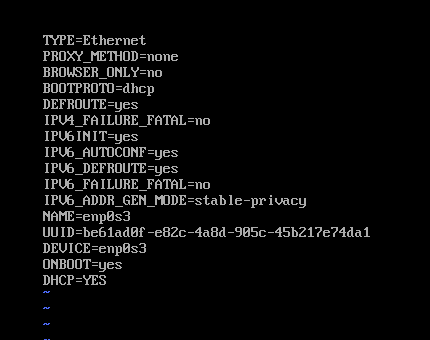
 
```bash
reboot
ip a
ping 8.8.8.8
ping www.perdu.com
```

installer nmap
```bash
yum install nmap

nmap 127.0.0.1 
```
le démon ssh est déjà installé

installation de nano
```bash
yum install nano
```

configuration de l’alias dans le bashrc
```bash
nano /root/.bashrc
```
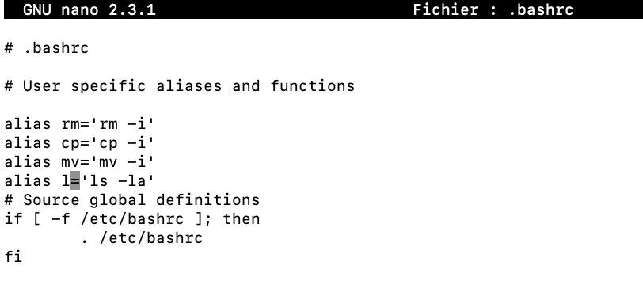

installation des utilitaires usuels du système
```bash
yum install zip
yum install samba
yum install openssl
yum install curl
yum install git
yum install screen
yum install lynx
yum install wget
```

install de webmin

tuto : [http://www.webmin.com/rpm.html](http://www.webmin.com/rpm.html)
```bash
wget http://prdownloads.sourceforge.net/webadmin/webmin-1.900-1.noarch.rpm
yum -y install perl perl-Net-SSLeay openssl perl-IO-Tty perl-Encode-Detect
rpm -Uvh webmin-1.900-1.noarch.rpm
```

gestion du Firewall IPTABLES

https://blog.microlinux.fr/iptables/
```bash
yum install iptables-services
systemctl disable firewalld.service
  
systemctl disable iptables.service
```
  
configuration d’apache
```bash
yum install httpd
systemctl enable httpd.service
systemctl restart httpd.service
```

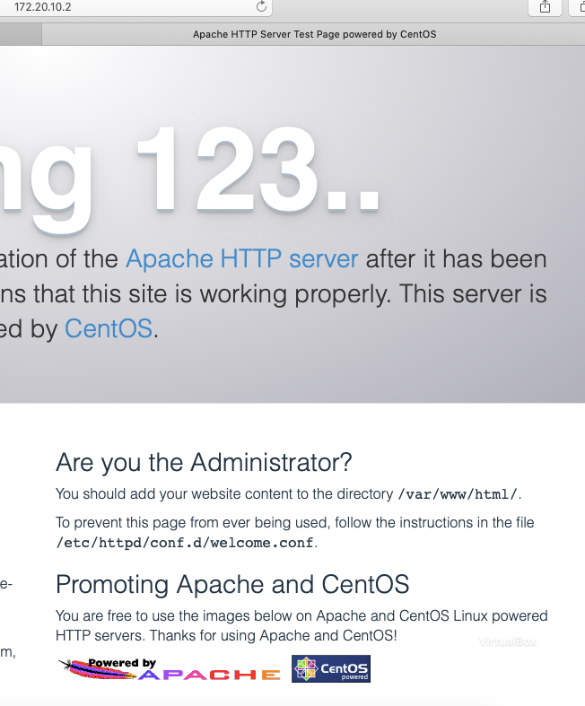

activer le mod ssl
```bash
yum install mod_ssl  
systemctl restart httpd
```

install mysql
tuto : https://www.linode.com/docs/databases/mysql/how-to-install-mysql-on-centos-7/
```bash
wget http://repo.mysql.com/mysql-community-release-el7-5.noarch.rpm
rpm -ivh mysql-community-release-el7-5.noarch.rpm
yum update
yum install mysql-server
systemctl enable mysqld.service
systemctl start mysqld
```