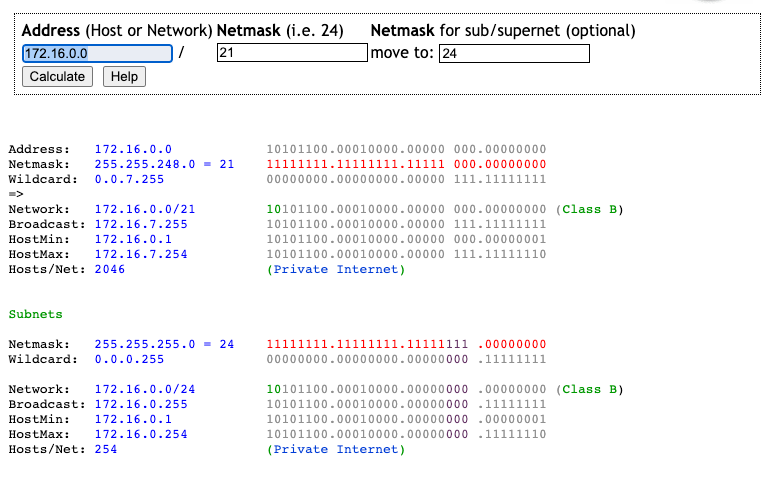

                                     

---

Monter une VM pour GLPI : [Support LAMPS](LAMPs.md)

Partie Entité
- Création d’un XMIND pour déterminer les entités / remplir les intitulés (types,modèles,matériels...)
- Installer le plugin Dashboard
- Personnaliser la couleur, le titre et/ou le logo de l’entreprise
- Créer les services (direction,compta,tech,téléphonie,commercial)
- Créer un intitulé pour son domaine (de l’entreprise)
- Créer le réseau 172.16.0.0/21
- Créer les vlan de chaque service selon une nomenclature de subnetting à partir de 172.16.0.0  

Partie User
- Création d’un User bien nommé chef de la DSI avec le pouvoir GLPI
- Création de 2 users bien nommé Tech membre du support et donc de la DSI
- Création de 4 Users Bien nommé membre de Post-only qui sont les chefs de services de votre entité sauf pour tech qui est déjà créer en chef du monde
- Créer l’usager Bruno dagen (login:bdagen, pwd:dadfba16) sur votre machine avec les pouvoirs post-only
- Générer un CSV de 100 users pour le service Téléphonie (generate data en ligne?)
- Installer le bon plugin pour son import
- Installer le plugin Fusion

Partie Helpdesk
- Créer une base de connaissance pour les post-only catégorisée
- Créer un FAQ pour les usagers post-only catégorisée
- Poster dans cette FAQ une procédure PDF sur les stratégie de mot de passe en entreprise (via le site de l’anssi)
- Générer un workflow complet de ticket (création d’un incident par un post-only,attribution par un tech à un autre tech, résolution, clôture)
- Générer un workflow complet de ticket (création d’un incident par bdagen ,attribution par un tech à un autre tech, résolution, clôture) avec bdagen chez votre voisin du bas 

Partie Inventory
- Créer une machine la plus complète à la main grâce aux intitulés
- Installer le Plugin Fusion dans GLPI*    
- Importer votre serveur ( localhost) dans les ordinateurs
- Importer via Fusion Inventory une autre machine (genre votre win10)
- Installer un plugin à votre guise 

* : http://fusioninventory.org/documentation/fi4g/installation.html  
http://fusioninventory.org/documentation/agent/installation/linux/deb.html

  

Supports Supplémentaires

  

- PDF 1 : [Gestion de Ticket dans GLPI ](IMG/Gestion-des-tickets-dans-GLPI.pdf)
- PDF 2 : [Base de Connaissances de GLPI](IMG/base-de-connaissance-GLPI.pdf)

--- 

# //TSSR → Appliquer les bonnes pratiques en centre de services (ITIL)

### Objectifs

ITIL (Information Technology Infrastructure Library) est un ensemble de bonnes pratiques pour améliorer la production informatique au service des objectifs métiers de l'entreprise.  
A l'issue de cette séance, le stagiaire sera capable , dans le cadre d'un centre de services (Hotline ou HelpDesk), de mettre en œuvre les processus de gestion d'incidents et de problèmes et communiquer avec l'équipe en charge du support aux utilisateurs dans un langage commun ITIL.  
Lors de la résolution d'incidents ou problèmes avec un logiciel de gestion d'incidents (comme GLPI), le stagiaire sera capable de documenter correctement les incidents en se référant à ce vocabulaire ITIL .  
Les processus ITIL visés dans cette séance sont ceux de la phase Exploitation de Services (Gestion des incidents, Gestion des problèmes, Gestion des événements, ...) et de la phase Transition de Services (Gestion des configuration, gestion des connaissances,...).  

### Consignes

Assurez-vous que vous avez déjà saisi un ticket incident précédemment lors de la séance "Utiliser le logiciel de gestion d'incidents (GLPI)" et que la base de problèmes et de connaissances est déjà alimentée. Si ce n'est pas le cas alimentez la base par des exemples types.  
Le stagiaire après lecture des documents "Sensibilisation à ITIL" et "ITIL-GestionIncidents" (voir ci-dessous) est amené à identifier le vocabulaire concrètement en analysant un ticket, un problème et un élément de la base de connaissances.  

### Vocabulaire
La prise en charge professionnelle du support aux utilisateurs, exige des bonnes pratiques et l'adoption d'un vocabulaire commun à une équipe de Hotline ou Help Desk décrit dans le référentiel ITIL. En étudiant les documents "Sensibilisation à ITIL" et "ITIL-GestionIncidents" vous découvrirez ce référentiel et les termes couramment utilisés dans un service d'assistance.  
Vous pouvez approfondir ce sujet en consultant le site Itil France : [http://www.itilfrance.com/](http://www.itilfrance.com/) et vos propres recherches sur Internet.  
Créez votre propre lexique des termes ITIL les plus importants dans le contexte du métier de l'assistance aux utilisateurs à retenir, à titre d'exemple :  
- Centre de services
- Fonction   
- Processus
- Rôle
- SLA
- KPI
- Gestion des Incidents
- Gestion des Problèmes
- Gestion des Configurations
- Erreur connue
- Escalade
- Base de connaissances
- CMDB
- ITSM
- RFC

Document pdf pour vous aider :
- [Sensibilisation ITIL](IMG/Sensibilisation-a-ITIL.pdf)
- [Gestion ITIL des Tickets](IMG/ITIL-GestionIncidents.pdf)

### Livrables

Lexique du vocabulaire ITIL adopté dans un centre de services.  
A créer en mode online (type office365) et déposer le lien dans

---
Mise en Pratique

### Consignes

A partir d'un ticket incident que vous avez déjà saisi dans la séance "Utiliser le logiciel de gestion d'incidents (GLPI)", puis d'un problème que vous aurez choisi dans la base des problèmes et d'un élément dans la base de connaissances vous ferez le lien entre le vocabulaire ITIL que vous avez étudié et son adoption dans le logiciel GLPI, en répondant au document "Questionnaire des incidents, problèmes et base de connaissances dans ITIL"

### Livrables

Réponse au [Questionnaire des incidents](IMG/Questionnaire-des-incidents-problemes-et-base-de-connaissances-dans-ITIL.pdf), problèmes et base de connaissances dans ITIL

---  

### Evaluation

cocher une ou plusieurs cases par question, lorsque plusieurs réponses sont attendues, leur nombre est indiqué. +1 point par réponse juste, 0 point par non-réponse, réponse fausse ou incomplète 

>- **Lesquels sont pour ITIL des bénéfices que l’entreprise retire de l’existence d’un Centre de service » ? (3 bonnes réponses)**
>1.  Amélioration du service et de sa perception par les utilisateurs  
>2.   Externalisation du service informatique
>3.   Meilleur contrôle des incidents et des requêtes des utilisateurs 
>4.  Optimisation de l’utilisation des ressources informatiques
>5.   Détermination des investissements informatiques à réaliser
>6.   Amélioration des relations avec les fournisseurs et les sous-traitants informatiques 

 

>- **Quel est l’objectif premier du « centre de service » au sens ITIL du terme ? (1 bonne réponse)**
>1.   Faire valider par le client le bon fonctionnement de son poste après une intervention
>2.   Résoudre immédiatement tous les incidents que peuvent signaler les utilisateurs
>3.   Etre le point de contact unique entre les utilisateurs et le service informatique
>4.   Etre un guichet unique pour tous les clients d’une entreprise 

 

>- **Dans la terminologie ITIL, le centre de service assure d’abord : (1 bonne réponse)**
>1.  les installations et les réparations des postes de travail informatiques 
>2.  le premier niveau de support aux utilisateurs informatiques 
>3.  le développement des applications informatiques de l’entreprise
>4.   un point d’accueil et d’information pour les nouveaux utilisateurs informatiques
 
 

>- **Dans le vocabulaire ITIL, Le centre de service est : (1 bonne réponse)**
>1.  Un processus 
>2.  Une Fonction
>3.  Un rôle  
>4.  Un incident

 

>- **Qu’est-ce qu’un « incident », au sens ITIL du terme ? (1 bonne réponse)**
>1. Un évènement dans un système, qui arrête un service ou altère sa qualité Disponibilité    
>2. Un problème technique mineur qui n’a pas d’impact grave sur le système informatique    
>3. Une difficulté rencontrée par l’utilisateur d’un poste informatique    
>4. Un problème technique qui est résolu soit par l’utilisateur, soit par le technicien
 
 

>- **La gestion des incidents est un processus qui fait partie du domaine suivant dans ITIL : (1 bonne réponse)**
>1.  Stratégie de services   
>2.  Conception de services    
>3.  Transition de services   
>4.  Exploitation des services

 

>- **Dans quelles conditions le processus de Gestion de Problèmes est déclenché ? (2 bonnes réponses)**
>1. es incidents récurrents sont traités, sans connaître leurs causes réelles.   
>2. Les utilisateurs se plaignent régulièrement de problèmes d’informatique    
>3. Plusieurs incidents présentent des symptômes similaires   
>4. Une personne importante dans l’entreprise s’est plainte d’un incident informatique

 

>- **Une « erreur connue » est : (1 bonne réponse)**
>1. n problème dont la cause a été identifiée, mais la correction non encore implémentée
>2. n incident pour lequel on a trouvé un contournement
>3. n problème corrigé  
>4. ne erreur sans importance 

 

>- **armi les suivants, quels sont les processus ITIL pris en charge dans GLPI ? (3 bonnes réponses)**
>1. Gestion des applications
>2.  Gestion des incidents
>3.  Gestion financière
>4.  Gestion des problèmes
>5.  Gestion des connaissances
>6.  Gestion de la sécurité

 

>- **A partir de quels critères, est estimée la priorité de traitement des incidents (2 bonnes réponses) ?**
>1. Date de création du ticket
>2.  Urgence pour le demandeur
>3.  Impact sur la qualité de service rendu
>4.  Les bonnes relations du demandeur avec le technicien**