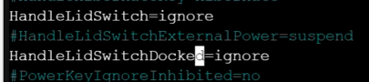
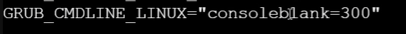

## GPU Passthrough

- [Ultimate Beginner's Guide to Proxmox GPU Passthrough](https://gist.github.com/qubidt/64f617e959725e934992b080e677656f)
- [Gaming VM setup (lucduke)](https://github.com/lucduke/proxmox/blob/main/3-vm-gaming.md)

---

## macOS VM

- [Guide: macOS 12 Monterey as a VM (r/homelab)](https://www.reddit.com/r/homelab/comments/qg37an/guide_to_installing_macos_12_monterey_as_a_vm_on/)
- [Installing macOS 12 Monterey on Proxmox 7 (Nick Sherlock)](https://www.nicksherlock.com/2021/10/installing-macos-12-monterey-on-proxmox-7/)
- [My macOS VM Proxmox setup (Nick Sherlock)](https://www.nicksherlock.com/2018/11/my-macos-vm-proxmox-setup/)

---

## Increase Storage (Single-Drive Install)

This merges `local-lvm` into `local` so the whole disk is usable. Only useful when Proxmox is installed on a single drive with the default **ext4/LVM** layout.

> ⚠️ This **deletes everything on `local-lvm`** (VM and container disks). Back up or move them first.

**1. Remove `local-lvm`**  
`Datacenter` > `Storage` > select `local-lvm` > **Remove** > Yes

**2. Resize the root volume**  
`Datacenter` > *your node* > **Shell**:

```shell
lvremove /dev/pve/data
lvresize -l +100%FREE /dev/pve/root
resize2fs /dev/mapper/pve-root
```

**3. Allow VM disks on `local`**  
`Datacenter` > `Storage` > select `local` > **Edit** > **Content**: add `Disk image` (and `Container` if needed)

---

## Laptop Tweaks

### Keep running with the lid closed

access the node shell and edit the service login file: 

```shell
nano /etc/systemd/logind.conf
```
then Uncomment these settings:


```ini
HandleLidSwitch=ignore
HandleLidSwitchExternalPower=ignore
HandleLidSwitchDocked=ignore
```
(`Ctrl+X`, `Y`, `Enter`) to save

---

### Turn the screen off (console blanking)

access the node shell and edit the grub file: 

```shell
nano /etc/default/grub
```

Add `consoleblank=` (in seconds) to the kernel line, e.g. 60 seconds:

```ini
GRUB_CMDLINE_LINUX_DEFAULT="quiet consoleblank=60"
```



(`Ctrl+X`, `Y`, `Enter`) to save

---
