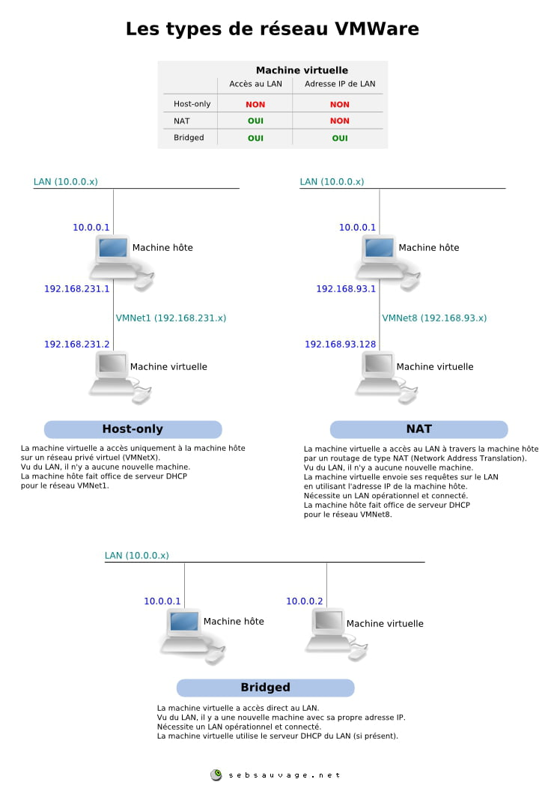

> ⚠️ **Disclaimer:** : all of this was written before Broadcom bought VMware, so some info may be out of date.

---

https://www.vmware.com/fr/products/workstation-player.html (Broadcom discontinued Workstation Player in May 2024, so I struck the link through and added a licensing section. Since November 2024, Workstation Pro has been free for every kind of use, including commercial. Downloads now come from the Broadcom Support Portal.)

---

## Change the Default VM Folder

**From the GUI:** `Edit` > `Preferences` > `Workspace` > *Default location for virtual machines*
or
manually changing default strorage path : \
in `%appdata%\VMware` open `preferences.ini` \
and change : `prefvmx.defaultvmpath = "D:\VM"`

---

## [**I copied it** vs **I moved it**](https://web.archive.org/web/20210903065502/https://communities.vmware.com/t5/VMware-Fusion-Discussions/I-copied-it-OR-I-moved-it-what-is-the-difference/td-p/1545488)
> If you select "I copied it" the following setting in the target Virtual Machine .vmx configuration file are changed. \
> `uuid.location` \
> `uuid.bios` \
> `ethernet0.generatedAddress` \
>
>Which makes the copied Virtual Machine appear uniquely different the the original however it's not totally unless you make the appropriate modifications at the Guest OS level as well however to Fusion it appears unique.
>
>If your running copies of the same Virtual Machine at the same time on the same system there would be network connectivity issues if the "ethernet0.generatedAddress" was not changed. If you're just moving or running a single copy of the target Virtual Machine at a time then you may want to chose "I moved it" to avoid possible activation issues with come OSes and or Software that registers the Ethernet MAC as part of its checksum.

**I Moved It** - should be used only, when you are manually moving a virtual machine between datastores, which includes moving to a new host and different datastore.

**I Copied It** - should be used when you want to COPY or CLONE a virtual machine, and used on the network at the same time as the original virtual machine. \
source [ [1](https://www.experts-exchange.com/articles/12515/HOW-TO-Select-the-right-answer-to-I-Moved-It-or-I-Copied-It-in-VMware-vSphere-ESXi.html) ] /
[[ 2](https://techhead.co/vmware-esx-i-moved-it-or-i-copied-it-whats-the-difference/)]

---

