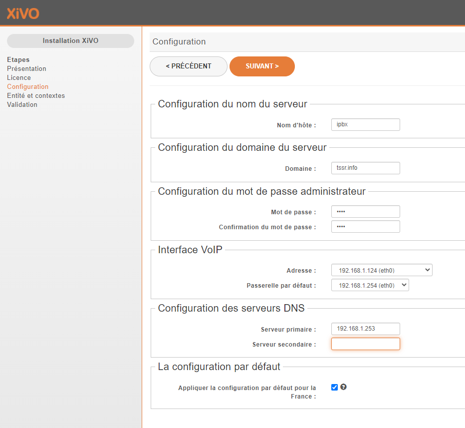
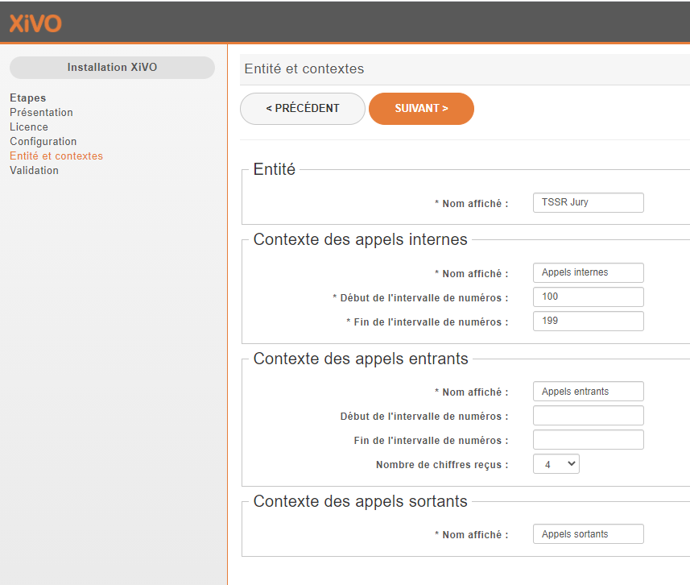
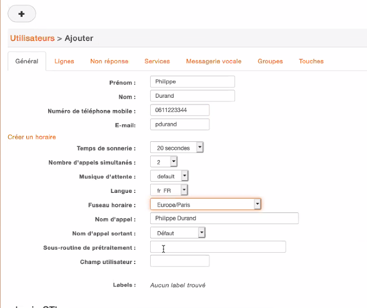
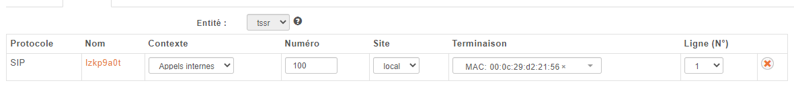
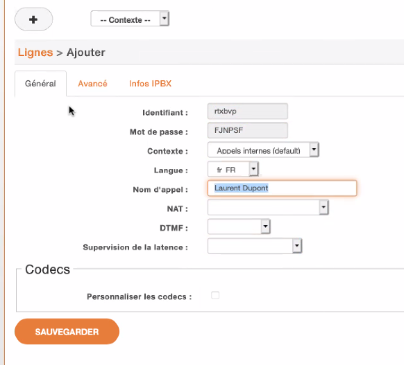
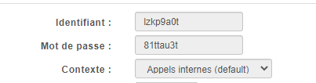

- Back to: [[_main\|Main Page]] | [[_VoIP]] | [[Xivo]]

---

# XiVO

**Docs:** [XiVO 2020.07 documentation](https://documentation.xivo.solutions/en/2020.07/index.html)

## Glossary

| Term | Meaning |
|---|---|
| **SDA** (DID) | Like a NAT rule, but for telephony: maps a public phone number to an internal extension |
| **Terminaison** (Device) | The phone itself: IP phone or softphone |
| **Ligne** (Line) | The SIP account, linked to a user and a device |
| **Provisioning** | Automatic configuration of the device by XiVO |

---

# Installation

1. Download the ISO: http://mirror.xivo.solutions/iso/
2. Boot the ISO and choose **Install**
3. Pick the language and set a **root password**
4. The rest is automatic and fairly quick. When it's done, the XiVO's **IP address is shown on screen**.

## Web setup wizard

Open `https://IP_ADDRESS/`:

| Step | Setting |
|---|---|
| 1 | Language |
| 2 | Hostname and administrator password |
| 3 | Entity name and number range |

Then confirm the summary.

---

# IPBX Configuration

**Configuration** > **Entités** (Entities): fill in the entity's details.

**Optional:**
- SSL certificate
- LDAP connection
- Voicemail
- Alert management
- **Greffons** (Plugins): refresh the list, then download the plugins for your phones

---

# Make Two Users Call Each Other (100 and 101)

All of the following is under **Services** > **IPBX** > **Paramètres IPBX** (IPBX settings).

### 1. Create the users
**Utilisateurs** (Users): create 2 users (one for 100, one for 101), then save.

### 2. Create the devices
**Terminaisons** (Devices) > **Ajouter** (Add): create one device per phone, with its **IP address** and **MAC address** (softphone or IP phone).

> **Tip:** For a softphone or a phone with no plugin, assign the `null` plugin (**greffon**) to the device to make its status turn green.

### 3. Give each user a line
Back in **Utilisateurs** (Users), edit a user, then in the **Lignes** (Lines) tab:
**Add a new line**, then choose a **number** and a **device**.

Repeat for the second user.

### 4. Get the SIP credentials
In the **Lignes** (Lines) menu, a line has been created for each user.
Click **Éditer** (Edit) to see the credentials to enter in the softphone or IP phone.

Repeat for the second user.

---

> **Quick recap**
> **Services** > **IPBX**:
> 1. **Utilisateurs**: create 2 users
> 2. **Terminaisons**: add one device per phone (IP + MAC)
> 3. **Utilisateurs** > **Lignes** tab: add a line (number + device) to each user
> 4. **Lignes** > **Éditer**: get the SIP credentials for each phone