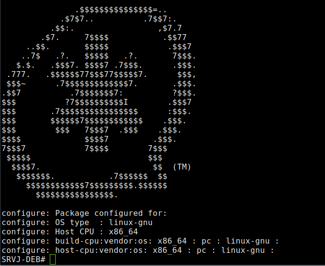
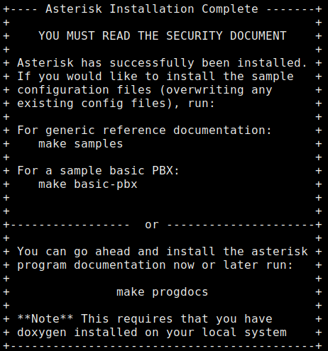

# Asterisk

https://linuxize.com/post/how-to-install-asterisk-on-debian-9/

Prérequis

Installer un serveur debian 9 (ou 10) dans lequel sera installé et compilé les binaires Asterisk. \
Si la machine est dans un réseau local, il peut s'avérer nécessaire de mettre en place un serveur/routeur (voir ici) notamment pour accéder à “l'extérieur” et en l'occurrence pour pouvoir passer des appels externes au sous-reséau local. \
Pour les tests, il faudra créer au moins 2 machines clientes dans le sous reseau pour tester les appels internes.


## Installation

**Téléchargement**
Télécharger les binaires sur le site officiel : https://www.asterisk.org/downloads/asterisk/all-asterisk-versions

En ligne de commande, pour la version 13 :

```
wget http://downloads.asterisk.org/pub/telephony/asterisk/asterisk-13-current.tar.gz
```

Décompresser l'archive :

```
tar -zxvf asterisk-13-current.tar.gz
```

Télécharger les packages et dépendances pour la compilation d'Asterisk

```
sudo apt-get install build-essential
sudo apt-get install git-core subversion libjansson-dev sqlite autoconf automake libxml2-dev libncurses5-dev libtool uuid-dev libsqlite3-dev
```

**Compilation**
Si présent, utiliser le script install_prereq pour installer tous les packages manquants:

```
./contrib/scripts/install_prereq install
```

Lancer l'outil de configuration depuis le répertoire d'Asterisk :

```
./configure
```

Si tout va bien on devrait obtenir ce logo :


```
                                   ░░▓▓▓▓▓▓▓▓▓▓▓▓▓▓▒▒                  
                               ▒▒▓▓▓▓▓▓▓▓▓▓▓▓▓▓▓▓▓▓▓▓▓▓▓▓  ░░
                           ▓▓▓▓▓▓▒▒                  ▒▒▓▓▓▓▒▒▒▒
                       ▓▓▓▓▒▒                            ▒▒▓▓▓▓▒▒▒▒
                   ▒▒▓▓▓▓                                  ▒▒▓▓▓▓▓▓       
                 ▓▓▓▓            ▓▓▓▓▓▓▓▓                    ▓▓▓▓▓▓▒▒     
               ▓▓▒▒              ▓▓▓▓▓▓▓▓                      ▓▓▓▓▓▓     
           ░░▓▓▒▒                ▓▓▓▓▓▓▓▓                      ▒▒▓▓▓▓▒▒   
         ▒▒▒▒▒▒      ▒▒▓▓░░      ▓▓▓▓▓▓▓▓      ▒▒▓▓              ▓▓▓▓▓▓   
         ▒▒▓▓        ▓▓▓▓▓▓▓▓    ▓▓▓▓▓▓▒▒  ▒▒▓▓▓▓▓▓▒▒            ▓▓▓▓▓▓   
       ▓▓▒▒▒▒      ▓▓▓▓▓▓▓▓▓▓▓▓▒▒▓▓▓▓▓▓▒▒▓▓▓▓▓▓▓▓▓▓▓▓            ▓▓▓▓▓▓   
     ▒▒▓▓▓▓        ░░▓▓▓▓▓▓▓▓▓▓▓▓▓▓▓▓▓▓▓▓▓▓▓▓▓▓▓▓▓▓▒▒            ▓▓▓▓▓▓   
     ▓▓▓▓▓▓            ▒▒▓▓▓▓▓▓▓▓▓▓▓▓▓▓▓▓▓▓▓▓▓▓▓▓                ▓▓▓▓▓▓   
   ▒▒▓▓▓▓                  ▓▓▓▓▓▓▓▓▓▓▓▓▓▓▓▓▓▓░░                  ▓▓▓▓▓▓   
   ▓▓▓▓▓▓                  ▓▓▓▓▓▓▓▓▓▓▓▓▓▓▓▓▓▓░░                ░░▓▓▓▓▒▒   
 ▒▒▓▓▓▓▓▓              ▒▒▓▓▓▓▓▓▓▓▓▓▓▓▓▓▓▓▓▓▓▓▓▓▓▓              ▓▓▓▓▓▓     
 ▓▓▓▓▓▓▓▓          ░░▓▓▓▓▓▓▓▓▓▓▓▓▓▓▓▓▓▓▓▓▓▓▓▓▓▓▓▓▓▓▒▒          ▓▓▓▓▓▓     
 ▓▓▓▓▓▓▒▒          ▓▓▓▓▓▓▓▓▓▓▓▓▒▒▓▓▓▓▓▓▓▓▓▓▓▓▓▓▓▓▓▓▓▓        ▒▒▓▓▓▓       
 ▓▓▓▓▓▓▓▓            ▓▓▓▓▓▓▓▓    ▓▓▓▓▓▓▓▓  ▒▒▓▓▓▓▓▓▒▒        ▓▓▓▓▓▓       
 ▓▓▓▓▓▓▓▓            ▒▒▓▓░░      ▓▓▓▓▓▓▓▓      ▓▓▓▓        ▓▓▓▓▓▓▒▒       
 ▓▓▓▓▓▓▓▓                        ▓▓▓▓▓▓▓▓                ▒▒▓▓▓▓▓▓         
 ░░▓▓▓▓▓▓▒▒                      ▓▓▓▓▓▓▓▓                ▓▓▓▓▓▓           
   ▓▓▓▓▓▓▓▓                      ▓▓▓▓▓▓▓▓              ▓▓▓▓▓▓             
   ▒▒▓▓▓▓▓▓▓▓                                          ▓▓▓▓░░             
     ▓▓▓▓▓▓▓▓▒▒                                          ▓▓               
       ▓▓▓▓▓▓▓▓▓▓                              ▒▒▓▓▒▒    ▓▓▓▓             
         ▓▓▓▓▓▓▓▓▓▓▒▒                    ▒▒▓▓▓▓▓▓▓▓▓▓▓▓▓▓░░▓▓             
         ░░▓▓▓▓▓▓▓▓▓▓▓▓▓▓▓▓▒▒▒▒▒▒▓▓▓▓▓▓▓▓▓▓▓▓▓▓▓▓▓▓▓▓▓▓▓▓▓▓▓▓▓▓           
           ▒▒▓▓▓▓▓▓▓▓▓▓▓▓▓▓▓▓▓▓▓▓▓▓▓▓▓▓▓▓▓▓▓▓▓▓▒▒      ▒▒▓▓▓▓▓▓           
             ▒▒▓▓▓▓▓▓▓▓▓▓▓▓▓▓▓▓▓▓▓▓▓▓▓▓▓▓▓▓                  ▒▒▒▒         
                 ░░▒▒▓▓▓▓▓▓▓▓▓▓▓▓▓▓▓▓░░
```

Pour lancer la compilation possibilité de passer par un menu assisté (optionnel) :

```
sudo make menuselect
```

et de lancer la compilation :

```
sudo make
```

**Installation**
Après la compilation qui peut durer quelques minutes, lancer la commande :

```
sudo make install
```



Maintenant qu'Asterisk est installé, l'étape suivante consiste à installer les exemples de fichiers de configuration.
Installer les fichiers de configuration génériques avec un exemple de documentation en exécutant:

```
sudo make samples
```

Installer les fichiers de configuration de base du PBX:

```
sudo make basic-pbx
```

La dernière étape consiste à installer le script d'initialisation Asterisk en tapant:

```
sudo make config
```

Exécuter ldconfig pour mettre à jour le cache des bibliothèques partagées:

```
sudo ldconfig
```

**Lancement du service**
Démarrer le service Asterisk 

```
sudo systemctl start asterisk
```

Lancer la console Asterisk

```
sudo asterisk -vvvr
```

Activer le service Asterisk pour démarrer au démarrage:

```
sudo systemctl enable asterisk
```

## Création d'un utilisateur Asterisk (optionnel)

Par défaut, Asterisk s'exécute en tant qu'utilisateur root. Pour des raisons de sécurité, il peut être utile de créer un nouvel utilisateur système et configurer Asterisk pour qu'il s'exécute en tant qu'utilisateur nouvellement créé.

```
sudo adduser --system --group --home /var/lib/asterisk --no-create-home --gecos "Asterisk PBX" asterisk
```

Pour configurer Asterisk pour qu'il s'exécute en tant qu'utilisateur asterisk, ouvrir le fichier /etc/default/asterisk et décommenter les deux lignes suivantes:

```
AST_USER="asterisk"
AST_GROUP="asterisk"
```

Ajouter l'utilisateur astérisque aux groupes de dialout et audio:

```
sudo usermod -a -G dialout,audio asterisk
```


Modifier la propriété et les autorisations de tous les fichiers et répertoires astérisk afin que l'utilisateur astérisk puisse accéder à ces fichiers :

```
sudo chown -R asterisk: /var/{lib,log,run,spool}/asterisk /usr/lib/asterisk /etc/asterisk
sudo chmod -R 750 /var/{lib,log,run,spool}/asterisk /usr/lib/asterisk /etc/asterisk
```

## Configuration du firewall (optionnel)

Par défaut, SIP utilise le port UDP 5060 pour ouvrir l'exécution du port:

```
sudo iptables -A INPUT -p udp -m udp --dport 5060 -j ACCEPT
```

Si le protocole en temps réel (RTP) est activé, ouvrir la plage de ports suivante:

```
sudo iptables -A INPUT -p udp -m udp --dport 10000:20000 -j ACCEPT
```

---

# Configuration IPBX

Configuration pour des appels internes

Pour créer les usagers VOIP, il faut modifier le fichier `/etc/asterisk/sip.conf`

Exemple de fichier de configuration pour 2 postes utilisateurs (à adapter) :

```
[general]
language=fr
allowguest=no
srvlookup=no
bindport=5060
bindaddr=0.0.0.0
qualify=yes
nat=force_rport,comedia
localnet=172.16.7.0/255.255.255.0
externip=192.168.20.36
externrefresh=15

[user-voip](!)
type=friend
context=internal
host=dynamic
disallow=all
allow=ulaw
allow=alaw

[101](user-voip)
username=user1
secret=user1
callerid="Utilisateur1" <101>
insecure=port,invite
nat=yes

[102](user-voip)
username=user2
secret=user2
callerid="Utilisateur2" <102>
insecure=port,invite
nat=yes
```

Pour vérifier que les comptes utilisateurs sont bien référencés :

```
sudo asterisk -rvvv
```

et

```
sip show peers
```


Pour le routage des appels, éditer le fichier /etc/asterisk/extensions.conf :

```
[internal]
exten => 101,1,Answer()
exten => 101,2,Dial(SIP/101,60)
exten => 101,3,Playback(vm-nobodyavail)
exten => 101,4,VoiceMail(101@mail.fr)
exten => 101,5,Hangup()

exten => 102,1,Answer()
exten => 102,2,Dial(SIP/102,60)
exten => 102,3,Playback(vm-nobodyavail)
exten => 102,4,VoiceMail(102@mail.fr)
exten => 102,5,Hangup()
```


Vérifier ensuite sur 2 postes clients, dans le même sous-réseau qu'Asterisk.

Installer sur ces 2 postes le logiciel Jitsi (par exemple) et configurer sur chacun de ces postes un compte utilisateur en reprenant les informations qui sont dans le fichier sip.conf.

Exemple : pour l'utilisateur 1, son identifiant sera 101 et son mdp user1, le registrar sera l'adresse IP du serveur Asterisk.

Normalement les 2 postes doivent pouvoir s'appeler mutuellement.
